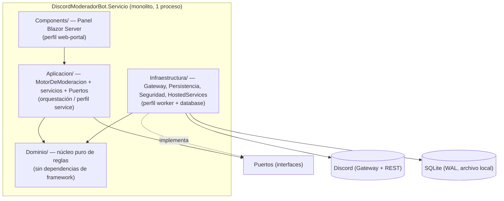

# Mapa del sistema

> Inventario de las piezas de software de la solución **Administrador de Bots Moderador para
> Discord**: tipo, tecnología, criticidad y estado documental. Es la entrada del nivel solución
> (Marco §5.2). Fuente primaria: `../../../../Discord.Bot.Moderador.Core/` (código) y su
> `DiscordModeradorBot.slnx`.

## Resumen ejecutivo

La solución es un **monolito web auto-hospedado** compuesto por **un único proyecto desplegable**,
`DiscordModeradorBot.Servicio`, que reúne en un solo proceso tres responsabilidades que en una
arquitectura distribuida serían servicios separados: el **panel de administración** (web-portal
Blazor), el **bot de moderación** (worker en segundo plano) y la **base de datos** (SQLite embebida).
Por eso, en términos del Marco §7, la pieza es un **monolito que combina los perfiles** `web-portal`
+ `service`/`worker` + `database`; cada perfil aplica a un módulo interno, no a un despliegue
independiente.

Alrededor del proyecto desplegable hay piezas de **soporte** que no se despliegan en producción
(pruebas, benchmarks, scripts, CI) pero forman parte de la solución y se documentan.

## Inventario de piezas

| Pieza | Ruta | `type` (Marco §7) | Tecnología | Criticidad | Se despliega |
|---|---|---|---|---|---|
| **DiscordModeradorBot.Servicio** | `src/DiscordModeradorBot.Servicio/` | `web-monolith` (combina `web-portal` + `service`/`worker` + `database`) | .NET 10, Blazor Server, MudBlazor 9.5, Discord.Net 3.20.1, EF Core 10 + SQLite | **Alta** | Sí (systemd linux-arm / Docker x64) |
| Servicio.Tests | `tests/DiscordModeradorBot.Servicio.Tests/` | soporte — pruebas unit/integración | xUnit, FluentAssertions, NSubstitute | Media | No |
| Servicio.E2E | `tests/DiscordModeradorBot.Servicio.E2E/` | soporte — pruebas e2e del panel | Playwright (.NET) | Media | No |
| Servicio.Benchmarks | `perf/DiscordModeradorBot.Servicio.Benchmarks/` | soporte — rendimiento | BenchmarkDotNet | Baja | No |
| Scripts de servicio | `scripts/servicio/` | soporte — publicación/instalación | Bash, PowerShell, systemd | Alta (operación) | Se instala en el dispositivo |
| Scripts de CI | `scripts/ci/` | soporte — gate de cobertura | PowerShell | Media | No |
| Pipelines CI/CD | `.github/workflows/` | soporte — automatización | GitHub Actions | Media | No |
| Empaquetado Docker | `Dockerfile`, `.dockerignore` | soporte — imagen x64 | Docker | Media | Sí (imagen de contenedor) |

> Solo `DiscordModeradorBot.Servicio` figura en la solución `DiscordModeradorBot.slnx` (junto con su
> proyecto de Tests). E2E y Benchmarks quedan **fuera de la solución** deliberadamente para no afectar
> el gate unitario (ver `../../../../Discord.Bot.Moderador.Core/README.md`).

## Módulos internos de la pieza desplegable

La pieza está organizada en **Clean Architecture por capas** (ADR-01, ADR-04). Cada módulo interno se
corresponde con un perfil documental del Marco §7:

| Módulo | Ruta | Responsabilidad | Perfil §7 aplicable |
|---|---|---|---|
| Dominio | `src/.../Dominio/` | Reglas de moderación puras: ráfaga, contenido, exenciones, políticas, incidentes, descriptores de configuración | (núcleo — base común) |
| Aplicación | `src/.../Aplicacion/` | Orquestación del pipeline (`MotorDeModeracion`), servicios de caso de uso, definición de puertos | `service` (lógica de aplicación) |
| Infraestructura | `src/.../Infraestructura/` | Adaptadores de Discord (real/simulado), persistencia EF/SQLite, cifrado y hash, servicios en segundo plano | `worker` + `database` |
| Panel (Components) | `src/.../Components/` | UI de administración: incidentes, servidores, configuración, exenciones, autenticación | `web-portal` |

## Criticidad y bus factor

- La pieza es de **criticidad alta**: es el único componente que ejecuta acciones de moderación
  irreversibles (baneos, borrado de mensajes) sobre servidores reales de Discord.
- El **modo Simulado** por defecto reduce el riesgo operativo: sin configuración explícita, la pieza
  no toca la plataforma real (ADR-04, ADR-13).
- Punto único de datos: **una base SQLite local** (sin réplica). El respaldo se documenta en
  operaciones (`07-operations/`), apoyado en `scripts/servicio/backup-sqlite.sh`.

## Estado documental por pieza

El gap documental calculable vive en [`../../docs-manifest.yaml`](../../docs-manifest.yaml). Resumen:

| Pieza | Documentación en este set |
|---|---|
| DiscordModeradorBot.Servicio | Nivel solución (`docs/01-architecture/`, `03-data/`, `04-decisions/`, `05-apis/`, `06-security-compliance/`, `07-operations/`, `08-onboarding/`) + nivel pieza (`docs/pieces/discordmoderadorbot-servicio/`) |
| Piezas de soporte (tests, perf, scripts, CI) | Cubiertas en el nivel solución: pruebas y calidad en la doc de la pieza; despliegue y CI en `07-operations/` y en la ia-db (`08_devops-despliegue`) |

## Referencias

- Visión y alcance: [`vision.md`](vision.md)
- Arquitectura detallada: [`../01-architecture/`](../01-architecture/)
- Documentación SDD 2.2 existente (fuente secundaria):
  `../../../../Discord.Bot.Moderador.Core/SDD2.2D/docs/`
