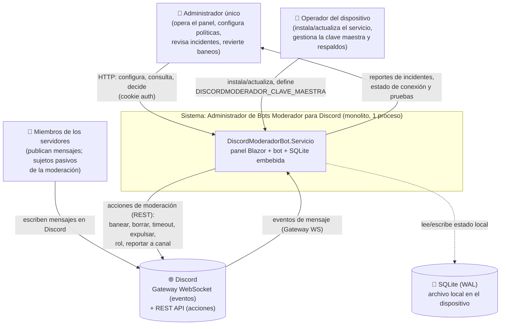

# Contexto del sistema (C4 nivel 1)

> Diagrama de contexto (C4 L1) de la solución **Administrador de Bots Moderador para Discord**:
> quién la usa, con qué sistemas externos habla y qué entra y sale. Fuente primaria de verdad:
> `../../../../Discord.Bot.Moderador.Core/src/DiscordModeradorBot.Servicio/`. El inventario de piezas
> vive en [`../00-overview/system-map.md`](../00-overview/system-map.md); los términos, en
> [`../../GLOSSARY.md`](../../GLOSSARY.md).

## Resumen ejecutivo

El sistema es un **monolito .NET 10 auto-hospedado, de un solo proceso** que un
**administrador único** opera desde un panel web para moderar automáticamente uno o más servidores
de **Discord**. El proceso reúne el panel de administración, el bot de moderación y una base SQLite
embebida (ver [`02-containers.md`](02-containers.md)). Hacia afuera se relaciona con **tres actores
humanos/operativos** y **un sistema externo** (Discord), y persiste todo su estado en un archivo
local del dispositivo. Por defecto arranca en **modo Simulado** (sin red ni token): no toca la
plataforma real hasta que un administrador lo configura explícitamente en modo Discord (ADR-04,
ADR-13).

## Diagrama de contexto

## Actores y sistemas externos

| Actor / sistema | Tipo | Interacción con el sistema | Traza |
|---|---|---|---|
| **Administrador único** | Persona (rol único) | Opera el panel web por HTTP con sesión por cookie: registra servidores, define políticas/reglas/exenciones, revisa incidentes, revierte baneos, cambia su contraseña | `Program.cs` (endpoints `/api/auth/*`), `ServicioAdministrador.cs` (CU-08, CU-09, RN-12, ADR-03) |
| **Operador del dispositivo** | Persona (rol operativo) | Instala/actualiza el servicio (systemd o Docker), provee la clave maestra `DISCORDMODERADOR_CLAVE_MAESTRA`, corre respaldos de la base | `scripts/servicio/instalar.sh`, `ServicioCifradoAes.cs` (ADR-05, ADR-07) |
| **Miembros de los servidores** | Personas (sujetos pasivos) | No usan el sistema directamente: publican mensajes en Discord, que el bot recibe y evalúa. Nunca autentican contra el panel | `Dominio/MensajeEntrante.cs`, `IAdaptadorGateway.MensajeRecibido` |
| **Discord** | Sistema externo | **Gateway WebSocket** entrega eventos de mensaje; **REST API** ejecuta las acciones de moderación. Se abre **una conexión por servidor** (modo Discord) | `IAdaptadorGateway.cs`, `AdaptadorGatewayDiscord.cs`, `GestorConexionesGateway.cs` (ADR-13) |
| **SQLite (archivo local)** | Almacén embebido | No es un sistema remoto: es un archivo en el dispositivo, dentro del mismo proceso. Se detalla en containers | `Program.cs` (PRAGMA WAL), `ContextoPersistencia.cs` (ADR-02) |

## Qué entra y qué sale del sistema

| Dirección | Contenido | Canal | Origen/Destino |
|---|---|---|---|
| **Entra** | Eventos de mensaje (autor, roles, canal, servidor, texto, instante) | Gateway WebSocket de Discord | Discord → bot |
| **Entra** | Configuración de moderación, credenciales de login, tokens de bot | HTTP (panel) | Administrador → panel |
| **Entra** | Clave maestra de cifrado, artefactos de despliegue | Variable de entorno / instalador | Operador → proceso |
| **Sale** | Acciones de moderación (banear con borrado retroactivo, timeout, expulsión, asignar/quitar rol, desbaneo) | REST API de Discord | bot → Discord |
| **Sale** | Reportes de incidentes en el canal de salida privado | REST API de Discord | bot → Discord (canal de incidencias) |
| **Sale** | Vistas del panel (incidentes, estado de conexión, resultado de pruebas de configuración) | HTTP | panel → Administrador |
| **Interno** | Estado persistente (servidores, políticas, incidentes, exenciones, administrador) | Archivo | proceso ↔ SQLite |

## Fronteras y decisiones que fijan el contexto

- **Un solo proceso, un solo actor humano con acceso**: no hay multiusuario ni RBAC; el único rol
  es el administrador único (RN-12, ADR-03). Los miembros de Discord nunca son usuarios del panel.
- **Discord es el único sistema externo**: no hay dependencias de terceros en tiempo de ejecución
  (sin colas, sin identidad federada, sin telemetría remota). El estado es 100 % local (ADR-02).
- **Modo Simulado por defecto** (ADR-04, ADR-13): sin configuración explícita, el sistema no abre
  red ni requiere token; el borde con Discord queda inactivo y un *walking skeleton* interno
  ejercita el pipeline con datos de demostración. El paso a **modo Discord** se decide por el flag
  `Moderacion:Gateway` (ver [`02-containers.md`](02-containers.md)).
- **Datos personales acotados**: el sistema procesa identificadores de Discord (snowflakes) y texto
  de mensajes que puede contener PII de miembros; su tratamiento y minimización se documentan en
  [`06-crosscutting.md`](06-crosscutting.md) (ADR-06, Ley 25.326).

## Referencias

- Nivel 2 (contenedores lógicos): [`02-containers.md`](02-containers.md)
- Inventario de piezas: [`../00-overview/system-map.md`](../00-overview/system-map.md)
- Visión y alcance: [`../00-overview/vision.md`](../00-overview/vision.md)
- Glosario: [`../../GLOSSARY.md`](../../GLOSSARY.md)
- Fuente secundaria (SDD 2.2): `../../../../Discord.Bot.Moderador.Core/SDD2.2D/docs/05_arquitectura_tecnica/arquitectura-solucion_v1.0.md`
