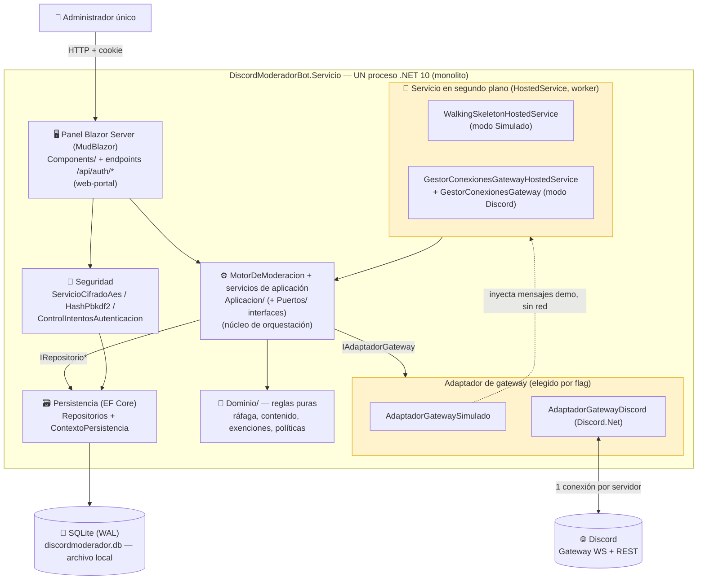
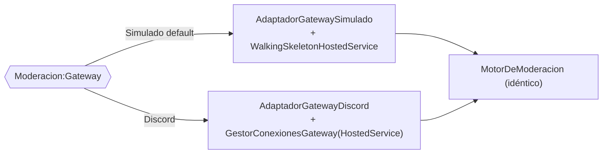

# Contenedores lógicos (C4 nivel 2)

> Vista de contenedores (C4 L2). **Importante:** en esta solución los "contenedores" del modelo C4
> **no son despliegues separados**: son **módulos de un mismo proceso .NET** (ADR-01). Se dibujan
> como contenedores lógicos porque en una arquitectura distribuida serían servicios aparte, pero
> aquí comparten proceso, memoria y ciclo de vida. El inventario canónico está en
> [`../00-overview/system-map.md`](../00-overview/system-map.md); no se duplica aquí.

## Resumen ejecutivo

El único proyecto desplegable, `DiscordModeradorBot.Servicio`, se organiza en **Clean Architecture
por capas** (ADR-01, ADR-04) y expone **tres contenedores lógicos** internos: el **panel Blazor
Server** (web-portal), el **servicio en segundo plano del bot** (worker) y la **base SQLite
embebida** (database). El corazón de aplicación es el **MotorDeModeracion**, compartido por ambos
frentes. Un único **flag de configuración**, `Moderacion:Gateway`, decide qué **adaptador de
gateway** se compone al arranque: `Simulado` (default, sin red) o `Discord` (real). Todo se cablea
en `Infraestructura/RegistroDependencias.cs`; el punto de entrada es
`src/DiscordModeradorBot.Servicio/Program.cs`.

## Diagrama de contenedores

> Los bloques resaltados (**adaptador de gateway** y **servicio en segundo plano**) son los que el
> flag `Moderacion:Gateway` intercambia al arranque; el resto del proceso es idéntico en ambos modos.

## Contenedores lógicos

| Contenedor lógico | Ruta | Perfil §7 | Responsabilidad | Tecnología |
|---|---|---|---|---|
| **Panel de administración** | `Components/` + `Program.cs` (`/api/auth/*`) | web-portal | UI de incidentes, servidores, configuración, exenciones y autenticación; emite/limpia la cookie de sesión | Blazor Server interactivo, MudBlazor 9.5 |
| **Servicio en segundo plano (bot)** | `Infraestructura/WalkingSkeletonHostedService.cs` · `Infraestructura/GestorConexionesGatewayHostedService.cs` + `Aplicacion/GestorConexionesGateway.cs` | worker | Recibe/inyecta mensajes y los enruta al `MotorDeModeracion`; en modo Discord abre y mantiene una conexión por servidor | `IHostedService`, Discord.Net 3.20.1 |
| **Base SQLite embebida** | `Infraestructura/Persistencia/` | database | Persiste servidores, políticas/eventos, reglas, exenciones, incidentes y administrador (13 tablas), snowflakes como TEXTO | EF Core 10 + SQLite, modo WAL |
| **Núcleo de aplicación/dominio** | `Aplicacion/` + `Dominio/` | service (núcleo) | Orquesta el pipeline (`MotorDeModeracion`) y aloja las reglas puras; independiente de framework y de Discord | .NET 10 puro |

## El flag de gateway: un solo interruptor de composición

El adaptador activo se elige **una sola vez, al arranque**, según `Moderacion:Gateway`
(`Infraestructura/Gateway/ModoGateway.cs`), leído en `Program.cs` y aplicado en
`RegistroDependencias.AgregarServiciosModeracion`:

| `Moderacion:Gateway` | Adaptador (`IAdaptadorGateway`) | Servicio en segundo plano | Red / token | Uso |
|---|---|---|---|---|
| `Simulado` (**default**) | `AdaptadorGatewaySimulado` | `WalkingSkeletonHostedService` (inyecta mensajes demo) | No | Desarrollo, pruebas, arranque seguro |
| `Discord` | `AdaptadorGatewayDiscord` (Discord.Net; también `IFabricaClienteGateway`) | `GestorConexionesGatewayHostedService` + `GestorConexionesGateway` (una conexión por servidor activo) | Sí | Producción real |

Ambos adaptadores implementan **la misma interfaz de puerto** `IAdaptadorGateway`
(`Aplicacion/Puertos/`), de modo que el `MotorDeModeracion` no cambia entre modos: solo cambia quién
está detrás del puerto (ADR-04). En modo Discord, el `GestorConexionesGateway` es **singleton de
larga vida** y resuelve los repositorios *scoped* en un scope efímero por uso, para no capturar una
dependencia *scoped* dentro de un *singleton*.

## Por qué son módulos, no despliegues

- **Un proceso, un binario**: systemd arranca un único ejecutable (`ExecStart`), y el contenedor
  Docker un único `ENTRYPOINT`; no hay orquestación de servicios (ver
  [`05-deployment.md`](05-deployment.md), ADR-01, ADR-05).
- **Memoria compartida**: el estado de conducta, el antirrebote y el estado de conexión viven en
  memoria del proceso (singletons); el panel y el bot los comparten sin IPC (ADR-09, ADR-13).
- **Una sola base local**: la SQLite es un archivo del propio proceso; el modo WAL tolera las
  escrituras concurrentes del bot y del panel dentro del proceso (ADR-02).
- El detalle del pipeline interno del `MotorDeModeracion` (contenedor crítico) se desarrolla en
  [`03-components.md`](03-components.md).

## Referencias

- Nivel 1 (contexto): [`01-context.md`](01-context.md)
- Nivel 3 (componentes del motor): [`03-components.md`](03-components.md)
- Despliegue: [`05-deployment.md`](05-deployment.md)
- Inventario de piezas y módulos: [`../00-overview/system-map.md`](../00-overview/system-map.md)
- Glosario: [`../../GLOSSARY.md`](../../GLOSSARY.md)
