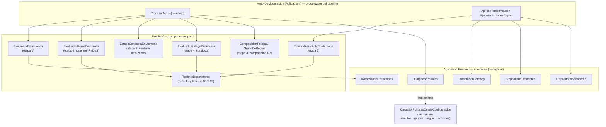

# Componentes del MotorDeModeracion (C4 nivel 3)

> Vista de componentes (C4 L3) del **contenedor crítico**: el `MotorDeModeracion` y sus
> colaboradores. Fuente de verdad:
> `../../../../Discord.Bot.Moderador.Core/src/DiscordModeradorBot.Servicio/Aplicacion/MotorDeModeracion.cs`.
> Los flujos de punta a punta se narran en [`04-runtime-views.md`](04-runtime-views.md).

## Resumen ejecutivo

El `MotorDeModeracion.ProcesarAsync(mensaje)` orquesta un **pipeline de 9 etapas** que lleva un
mensaje entrante desde el descarte de exentos hasta el registro del incidente. El motor es un
**orquestador delgado**: la lógica de decisión vive en **componentes de dominio puros**
(evaluadores, estado en memoria) y el acceso al mundo exterior pasa por **puertos** (`IAdaptadorGateway`,
`ICargadorPoliticas`, `IRepositorio*`). El resultado de un incidente se clasifica en
`Ejecutada`, `Simulada`, `NoAccionable` o `Fallida`, donde el **"peor" resultado gana**; una
jerarquía superior o permisos faltantes lo dejan `NoAccionable` pero **el pipeline no se cae y aun
así reporta** (RN-01, ADR-08).

## Las 9 etapas del pipeline

| # | Etapa | Componente(s) principal(es) | Efecto | Traza |
|---|---|---|---|---|
| 1 | Descarte de exentos | `EvaluadorExenciones` + `IRepositorioExenciones` | Si emisor, rol o canal está exento, termina YA (sin tocar estado ni registrar) | RN-07, CU-15 |
| 2 | Reglas de contenido (sin estado) | `EvaluadorReglaContenido` | Evalúa el texto contra cada regla de contenido; tope de tiempo anti-ReDoS | CU-04, ADR-08 |
| 3 | Actualizar estado de conducta | `EstadoConductaEnMemoria` | Registra la actividad del mensaje en la ventana deslizante | ADR-09 |
| 4 | Evaluar políticas por prioridad | `ComposicionPolitica` / `EvaluadorRafagaDistribuida` / paso 2 | Primera coincidencia (orden por prioridad) dispara; `Continuar` sigue | RN-04 |
| 5 | Copia de evidencia | `MensajeAccionado` (+ canales) | Copia mensajes y canales ANTES de cualquier borrado | RN-11 |
| 6 | Decisión de modo | `Politica.Modo` | En `Simulacion` no ejecuta acciones reales, solo registra | RN-09 |
| 7 | Antirrebote por usuario | `EstadoAntirreboteEnMemoria` | Suprime la acción repetida sobre un usuario ya accionado en la ventana | RN-06, CU-16, ADR-09 |
| 8 | Ejecución de acciones en orden | `IAdaptadorGateway` | Ejecuta acciones ordenadas; mapea `ResultadoAccion`→`ResultadoModeracion` | RN-05, RN-01 |
| 9 | Registro del incidente | `IRepositorioIncidentes` | Persiste el incidente con su evidencia y resultado | RN-11 |

## Diagrama de componentes

## Responsabilidad y relación por componente

| Componente | Capa | Responsabilidad | Estado | Relación con el motor |
|---|---|---|---|---|
| **MotorDeModeracion** | Aplicación | Orquesta las 9 etapas; clasifica el incidente por el peor resultado | Sin estado propio (usa colaboradores) | Punto de entrada `ProcesarAsync` |
| **EvaluadorExenciones** | Dominio | Predicado puro: emisor/rol/canal exento (etapa 1) | Sin estado | Descarte previo; lee exenciones vía `IRepositorioExenciones` |
| **EvaluadorReglaContenido** | Dominio | Predicado sin estado sobre el texto; captura `RegexMatchTimeoutException` y la trata como no coincidencia señalada (etapa 2) | Sin estado | Devuelve `Coincide`/`ExcedioTope` al motor |
| **EstadoConductaEnMemoria** | Dominio | Ventana deslizante de actividad por usuario/servidor; cuenta canales distintos (etapa 3) | **En memoria** (singleton) | `RegistrarActividad` + consultas |
| **EvaluadorRafagaDistribuida** | Dominio | Regla de conducta: ¿canales distintos ≥ umbral? Umbral/ventana desde descriptores (etapa 4) | Sin estado (lee `EstadoConducta`) | Coincidencia de política de conducta |
| **ComposicionPolitica / GrupoDeReglas** | Dominio | Combina grupos de reglas (contenido y/o conducta) por modo de coincidencia (etapa 4, R7) | Sin estado | Resuelve el disparo de políticas con composición (RN-15) |
| **EstadoAntirreboteEnMemoria** | Dominio | Suprime repeticiones sobre un usuario ya accionado en la ventana (etapa 7) | **En memoria** (singleton) | `DebeSuprimir` / `RegistrarAccion` |
| **RegistroDescriptores** | Dominio | Fuente única de defaults y límites (umbral, ventanas, tope de tiempo) | Estático | Normaliza parámetros configurados (ADR-12, RN-10) |
| **ICargadorPoliticas → CargadorPoliticasDesdeConfiguracion** | Puerto / Aplicación | Carga las políticas del servidor desde la configuración persistida (eventos→grupos→reglas→acciones); tolerante a configuración incompleta | Sin estado (usa repos scoped) | Provee políticas y parámetros por servidor (CU-11, RN-15, ADR-08) |
| **IAdaptadorGateway** | Puerto | Ejecuta acciones reales (banear+borrado, timeout, expulsar, rol, reportar) y devuelve `ResultadoAccion` (etapa 8) | — | Único borde de salida hacia Discord (o simulado) |
| **IRepositorioIncidentes / Servidores / Exenciones** | Puerto | Persistencia y lectura de incidentes, canal de salida y exenciones | — | Etapas 1, 5, 8 (reporte) y 9 |

## Detalles de diseño que importan

- **Orquestador delgado, dominio rico**: el motor no decide *qué* es una ráfaga o *qué* está
  exento; delega en evaluadores puros y solo secuencia y clasifica (ADR-01, ADR-04).
- **Simulación es la primera barrera de ejecución** (etapa 6, antes del antirrebote): en
  `Simulacion` nunca se invoca al adaptador ni se toca el antirrebote; solo se registra el incidente
  como `Simulada` (RN-09).
- **Antirrebote y estado de conducta son efímeros** (en memoria, singletons): no se persisten; se
  pierden al reiniciar, lo cual es aceptable por diseño (ADR-09).
- **Clasificación por peor resultado**: `EjecutarAccionesAsync` agrega los resultados de contención
  con `PeorResultado` (NoAccionable > Fallida > Ejecutada) y reclasifica el incidente en cuanto se
  conoce el resultado, de modo que un reporte posterior ya incluya la advertencia de "no accionable"
  (RN-01, ADR-08).
- **Acción representativa del incidente**: la primera acción de contención sobre el usuario si
  existe; si no, la primera acción declarada (el detalle por acción vive en la configuración).

## Referencias

- Flujos punta a punta con datos sintéticos: [`04-runtime-views.md`](04-runtime-views.md)
- Contenedores: [`02-containers.md`](02-containers.md)
- Conceptos transversales (tope de tiempo, resiliencia, config): [`06-crosscutting.md`](06-crosscutting.md)
- Glosario: [`../../GLOSSARY.md`](../../GLOSSARY.md)
- Fuente secundaria (SDD 2.2): `../../../../Discord.Bot.Moderador.Core/SDD2.2D/docs/05_arquitectura_tecnica/flujo-ejecucion_v1.0.md`
