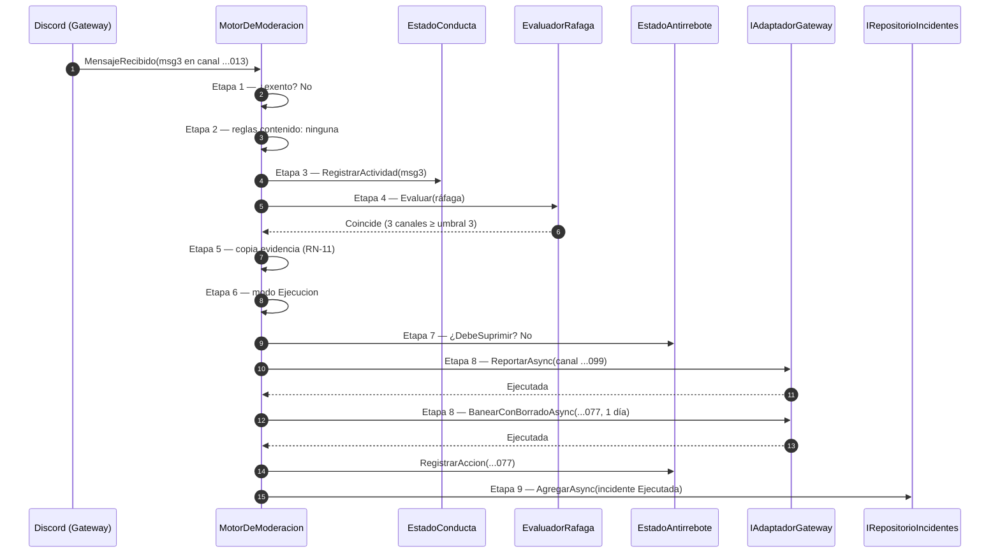
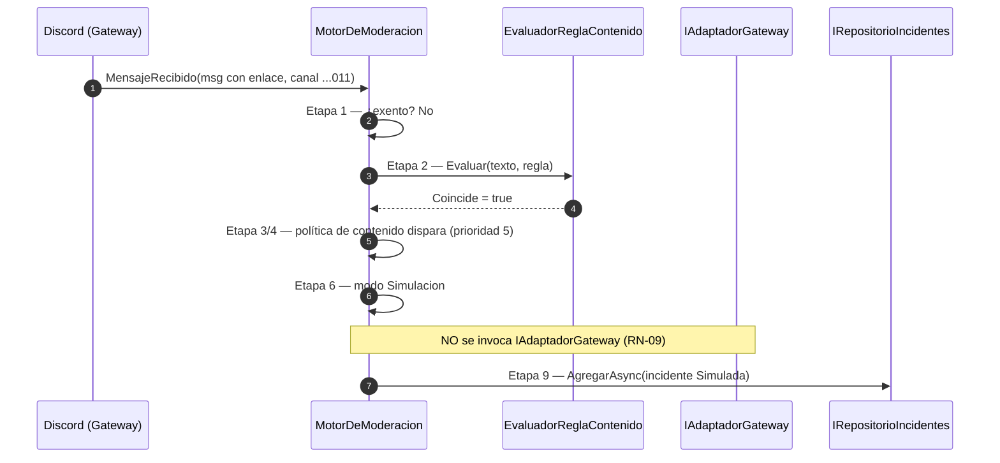
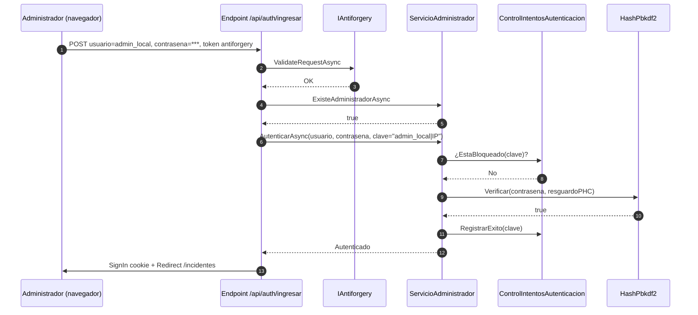

# Vistas de runtime — flujos punta a punta

> Cinco flujos representativos del sistema, con **datos sintéticos coherentes** (snowflakes
> ficticios de 18 dígitos, seudónimos; nunca PII ni tokens reales) y un `sequenceDiagram` por flujo.
> Cada flujo cruza el pipeline de 9 etapas descrito en [`03-components.md`](03-components.md). Fuente
> de verdad: `MotorDeModeracion.cs` y `Program.cs`.

## Datos sintéticos compartidos

| Elemento | Valor sintético | Nota |
|---|---|---|
| Servidor | `100000000000000042` | "Servidor Demo" |
| Canal de salida (incidencias) | `300000000000000099` | privado |
| Canales de charla | `300000000000000011`, `...012`, `...013` | |
| Usuario spammer | `200000000000000077` | seudónimo `usuario_gamma` |
| Usuario moderador (exento por rol) | `200000000000000005` | rol `500000000000000050` |
| Administrador del panel | `admin_local` | rol único |

---

## Flujo A — Ráfaga distribuida baneada con borrado retroactivo (modo Ejecución)

**Precondiciones:** servidor `...042` activo en modo Discord; política de conducta "Ráfaga
distribuida" en `Ejecucion`, prioridad 10, acciones `Reportar`→`BaneoConBorradoRetroactivo` (1 día);
umbral 3 canales / ventana 2 s; `usuario_gamma` no exento; sin acción previa en la ventana de
antirrebote.

**Pasos:** `usuario_gamma` publica en `...011`, `...012` y `...013` en < 2 s. Al tercer mensaje:
(1) no exento → (2) sin regla de contenido → (3) se registra actividad → (4) la ráfaga alcanza el
umbral (3 ≥ 3) → (5) se copia la evidencia (RN-11) → (6) modo Ejecución → (7) sin supresión → (8)
reporta al canal `...099` y banea con borrado de 1 día → (9) registra incidente.



**Resultado esperado:** incidente `Ejecutada`; el emisor queda baneado, sus mensajes de la última
jornada purgados (tope 7 días, RN-02), reporte publicado en `...099`. **Traza:** CU-01, CU-02, CU-03,
CU-05, RN-04, RN-05, RN-11.

---

## Flujo B — Regla de contenido que coincide en modo Simulación (no ejecuta)

**Precondiciones:** política de contenido "Enlaces sospechosos" en `Simulacion`, prioridad 5, regla
regex que matchea `http://` no permitidos; acciones `Reportar`→`Banear`. `usuario_gamma` no exento.

**Pasos:** publica un mensaje con un enlace. (1) no exento → (2) la regla de contenido coincide →
(3) se registra actividad → (4) primera coincidencia por prioridad = política de contenido → (6)
**modo Simulación**: se registra lo que se *habría* hecho, **sin invocar al adaptador ni tocar el
antirrebote** → (9) incidente `Simulada`.



**Resultado esperado:** incidente `Simulada`; **ninguna** acción real contra Discord; log de "se
habrían ejecutado N acciones". **Traza:** CU-04, RN-09.

---

## Flujo C — Mensaje descartado por exención (etapa 1)

**Precondiciones:** existe una exención por **rol** `500000000000000050` en el servidor `...042`.
`usuario_moderador` (`...005`) porta ese rol.

**Pasos:** el moderador publica en varios canales rápidamente. En la etapa 1, el
`EvaluadorExenciones` detecta el rol exento y el pipeline **termina de inmediato**: no se evalúa
contenido ni conducta, **no se registra actividad** (no contribuye a una ráfaga posterior), no se
dispara política y no se registra incidente.

```mermaid
sequenceDiagram
    autonumber
    participant D as Discord (Gateway)
    participant M as MotorDeModeracion
    participant RE as IRepositorioExenciones
    participant EX as EvaluadorExenciones
    participant EC as EstadoConducta

    D->>M: MensajeRecibido(msg de usuario_moderador ...005)
    M->>RE: Etapa 1 — ListarPorServidorAsync(...042)
    RE-->>M: [exención por rol 500000000000000050]
    M->>EX: EstaExento(msg, exenciones)
    EX-->>M: true (rol del autor coincide)
    Note over M,EC: NO se registra actividad; pipeline termina (return null)
    M-->>D: (sin acción, sin incidente)
```

**Resultado esperado:** `ProcesarAsync` devuelve `null`; cero efectos secundarios. **Traza:** CU-15,
RN-07.

---

## Flujo D — Antirrebote suprime una acción repetida

**Precondiciones:** continúa la ráfaga del **Flujo A**; el `usuario_gamma` ya fue accionado hace
1 s; ventana de antirrebote 10 s. Llega un cuarto mensaje que **vuelve a disparar** la misma
política de conducta.

**Pasos:** (1)-(4) igual que el Flujo A y la política coincide otra vez → (6) modo Ejecución → (7)
`EstadoAntirrebote.DebeSuprimir` devuelve **true** (usuario ya accionado dentro de la ventana): la
acción se **suprime** (0 acciones adicionales), **no se reinvoca al adaptador** y **no se crea un
incidente nuevo**.

```mermaid
sequenceDiagram
    autonumber
    participant D as Discord (Gateway)
    participant M as MotorDeModeracion
    participant EV as EvaluadorRafaga
    participant AB as EstadoAntirrebote
    participant G as IAdaptadorGateway

    D->>M: MensajeRecibido(msg4, canal ...012)
    M->>M: Etapa 1-3 — no exento, actividad registrada
    M->>EV: Etapa 4 — Evaluar(ráfaga)
    EV-->>M: Coincide de nuevo
    M->>M: Etapa 6 — modo Ejecucion
    M->>AB: Etapa 7 — DebeSuprimir(...077, ventana 10s)?
    AB-->>M: true (ya accionado hace 1s)
    Note over M,G: 0 acciones adicionales; NO se invoca al adaptador (RN-06)
    M-->>D: (return null, sin nuevo incidente)
```

**Resultado esperado:** `ProcesarAsync` devuelve `null`; se evita el incidente duplicado durante el
mismo ataque. **Traza:** CU-16, RN-06, ADR-09.

---

## Flujo E — Login del administrador (POST /api/auth/ingresar)

**Precondiciones:** ya existe la cuenta del administrador (first-run completado); resguardo PBKDF2
persistido; el panel se sirve por HTTP; token antiforgery emitido por la página `/ingresar`.

**Pasos:** el administrador postea usuario+contraseña. El endpoint (1) valida el token antiforgery →
(2) confirma que existe cuenta → (3) compone la clave de intentos (`usuario|IP`) → (4) autentica
contra `ServicioAdministrador` (que usa `ControlIntentosAutenticacion` y `HashPbkdf2`) → (5) ante
éxito, emite la cookie de sesión y redirige a `/incidentes`.



**Resultado esperado:** sesión abierta (cookie `DiscordModerador.Auth`, 8 h, HttpOnly, SameSite
Strict, Secure según request). Con credenciales inválidas se redirige con mensaje neutro
(`AUTH_CREDENCIALES_INVALIDAS`, sin enumeración de cuentas); tras 5 fallos en 15 min se bloquea
15 min (`AUTH_DEMASIADOS_INTENTOS`). **Traza:** CU-09, RN-12, ADR-03.

## Referencias

- Componentes del pipeline: [`03-components.md`](03-components.md)
- Seguridad y resiliencia transversales: [`06-crosscutting.md`](06-crosscutting.md)
- Glosario: [`../../GLOSSARY.md`](../../GLOSSARY.md)
- Fuente secundaria (SDD 2.2): `../../../../Discord.Bot.Moderador.Core/SDD2.2D/docs/05_arquitectura_tecnica/flujo-ejecucion_v1.0.md`
