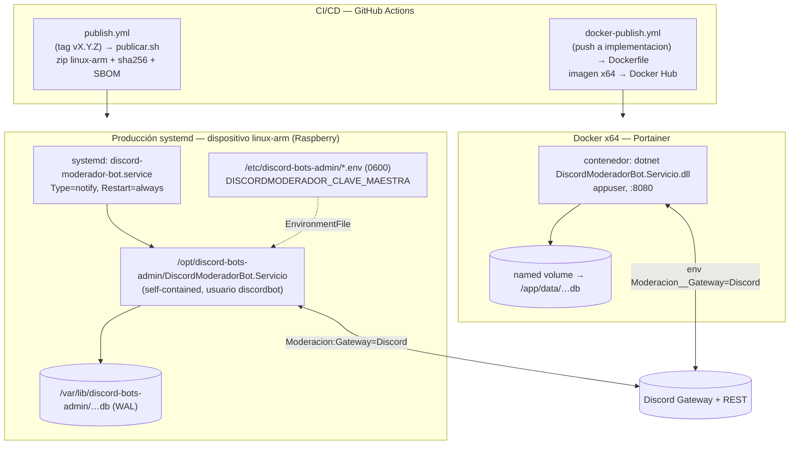

# Despliegue — ambientes, artefactos y topología

> Cómo se compone y despliega el monolito en cada ambiente. Fuente de verdad: `Program.cs`,
> `scripts/servicio/`, `Dockerfile` y `.github/workflows/`. El sistema es **un único proceso** en
> todos los ambientes (ADR-01); lo que cambia es el empaquetado, el flag de gateway y el mecanismo
> de arranque.

## Resumen ejecutivo

Hay **cuatro ambientes**: **Development** (modo Simulado, `dotnet run`), **E2E** (entorno de pruebas
del panel con SQLite temporal y endpoints de sembrado), **Producción systemd** (paquete
self-contained `linux-arm` sobre un dispositivo Raspberry, unidad `discord-moderador-bot.service`) y
**Docker** (imagen `linux/amd64` con volumen para la base). El artefacto de producción por
excelencia es el **zip self-contained linux-arm** (no requiere runtime instalado), generado por
`scripts/servicio/publicar.sh` y publicado por el workflow `publish.yml` ante un tag SemVer. La
imagen Docker la publica `docker-publish.yml` al hacer merge a la rama `implementacion`.

## Matriz de ambientes

| Ambiente | Arranque | `Moderacion:Gateway` | Persistencia | Clave maestra | Uso |
|---|---|---|---|---|---|
| **Development** | `dotnet run` (`ASPNETCORE_ENVIRONMENT=Development`) | `Simulado` (default) | `discordmoderador.db` junto al ejecutable | Derivada de dev (sin variable) | Desarrollo local |
| **E2E** | `WebApplicationFactory` / build no publicado (`ASPNETCORE_ENVIRONMENT=E2E`) | `Simulado` | SQLite temporal por corrida (`Persistencia:RutaBase`) | Derivada de dev | Pruebas Playwright del panel |
| **Producción systemd** | `systemd` (`Type=notify`, `Restart=always`) | `Discord` | `/var/lib/discord-bots-admin/…` (WAL) | `DISCORDMODERADOR_CLAVE_MAESTRA` en `.env` 0600 | Dispositivo linux-arm |
| **Docker** | `ENTRYPOINT dotnet …dll` como `appuser` | `Simulado` (default de imagen; se pone `Discord` por env) | Volumen `/app/data/discordmoderador.db` | `Moderacion__…` / clave por env (Portainer) | Contenedor x64 / Portainer |

> En **E2E** se habilita `UseStaticWebAssets()` y se montan endpoints `/e2e/seed/*` (solo en ese
> entorno) para preparar estado determinista; **no existen en dev ni en producción** (no son
> superficie de ataque). El PRAGMA `journal_mode=WAL` y la migración se aplican al arranque en todos
> los ambientes (`Program.cs`, ADR-02).

## Artefactos de despliegue

| Artefacto | Generado por | Contenido | Destino |
|---|---|---|---|
| `discord-bots-admin_<X.Y.Z>_linux-arm.zip` | `scripts/servicio/publicar.sh` (STAGE-11) | Binario self-contained `linux-arm` + `libe_sqlite3.so` + `servicio/` (instalar.sh, unidad, `.env.example`) | Release de GitHub (systemd) |
| `…zip.sha256` | `publicar.sh` | Checksum SHA-256 del zip | Release (verificación de integridad) |
| `…_sbom.json` | `publish.yml` (CycloneDX) | SBOM CycloneDX del proyecto | Release (supply chain) |
| Imagen `…/discord-bot-moderador:latest` + `:<sha>` | `docker-publish.yml` (multi-stage `Dockerfile`) | Runtime `aspnet:10.0`, usuario no-root, `VOLUME /app/data` | Docker Hub → Portainer |
| Unidad `discord-moderador-bot.service` | `scripts/servicio/` | Servicio systemd endurecido (`NoNewPrivileges`, `ProtectSystem=full`, `ReadWritePaths`) | `/etc/systemd/system/` |

## Topología de despliegue

## Composición por ambiente (detalle)

- **Producción systemd (ADR-05):** el instalador `instalar.sh` es idempotente y **preserva** el
  `.env` (clave maestra) y la base SQLite entre reinstalaciones y rollbacks (§17 P.8, ADR-07): los
  tokens cifrados siguen siendo válidos. La unidad corre como usuario `discordbot` sin privilegios,
  con `ReadWritePaths=/var/lib/discord-bots-admin` y logs al journal. El paquete es
  **self-contained** (cross-compilado desde x64), por lo que el dispositivo no necesita el runtime
  .NET instalado.
- **Docker (ADR-14):** imagen multi-stage (SDK build → `aspnet` runtime), usuario no-root
  (uid/gid 1001), `VOLUME ["/app/data"]` para persistir la base, `ASPNETCORE_URLS=http://+:8080`.
  El default de imagen es `Moderacion__Gateway=Simulado` (default seguro); en producción se pone
  `Discord` y la clave maestra por variables de entorno en Portainer (12-factor).
- **Development / E2E:** sin clave maestra explícita (se deriva una de desarrollo determinista, **no
  apta para producción**, ver [`06-crosscutting.md`](06-crosscutting.md)); gateway Simulado; base
  local o temporal.

## Gates de CI antes de publicar

Ambos workflows corren, antes de empaquetar: `dotnet build -c Release -warnaserror`, `dotnet test`
con cobertura (`coverlet.runsettings`) y el **gate de cobertura** (`scripts/ci/verificar-cobertura.ps1`).
El versionado es SemVer derivado de Git con Nerdbank.GitVersioning (`nbgv`), no se parsea el tag a
mano.

## Referencias

- Contenedores lógicos: [`02-containers.md`](02-containers.md)
- Conceptos transversales (clave maestra, WAL): [`06-crosscutting.md`](06-crosscutting.md)
- Inventario de piezas: [`../00-overview/system-map.md`](../00-overview/system-map.md)
- Fuente secundaria (SDD 2.2): decisiones ADR-05/ADR-14 en `../../../../Discord.Bot.Moderador.Core/SDD2.2D/docs/05_arquitectura_tecnica/adrs/`
