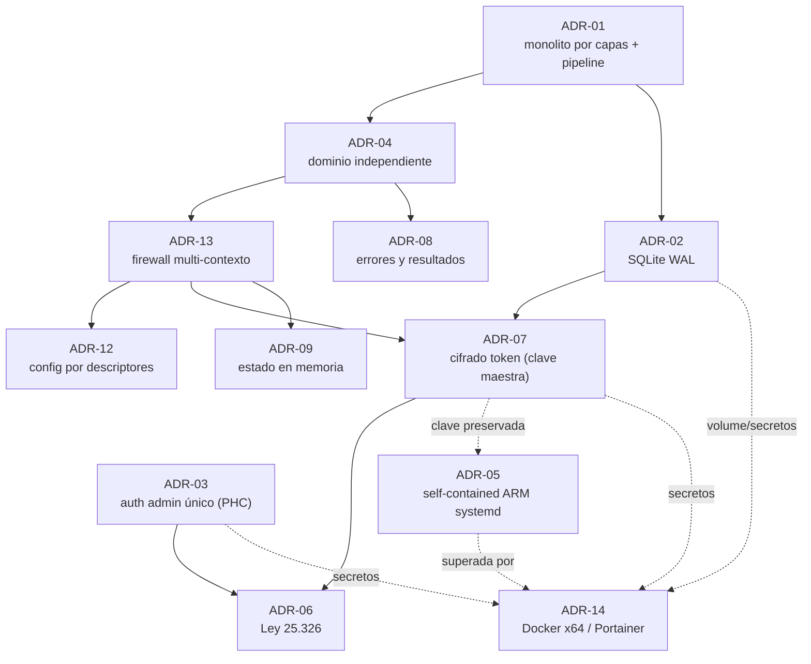

# Catálogo de decisiones de arquitectura (ADR)

> Índice navegable y trazable de las **14 ADR** de la solución **Administrador de Bots Moderador
> para Discord**. Este documento **cataloga y referencia**; no reescribe las decisiones.
> Glosario canónico: [`../../GLOSSARY.md`](../../GLOSSARY.md).

## Naturaleza y fuente autoritativa

- **La fuente autoritativa de cada ADR es la SDD 2.2**, en
  `../../../../Discord.Bot.Moderador.Core/SDD2.2D/docs/05_arquitectura_tecnica/adrs/`. Este catálogo
  las indexa para navegación y trazabilidad (SSOT: se referencia, no se duplica).
- **Las ADR aceptadas son inmutables.** La única edición permitida sobre una ADR aceptada es el
  cambio de estado a `Superado por ADR-YY` (ver control de cambios de cada ADR). Toda revisión de
  una decisión se hace emitiendo una **nueva** ADR que supere a la anterior.
- Estado observado: **13 aceptadas** y **1 superada** (ADR-05 → superada por ADR-14). La columna
  Fuente enlaza al archivo autoritativo por ruta relativa.

## Catálogo

| ADR | Título | Estado | Decisión (1 línea) | Traza (RN / CU / NB) | Fuente |
|---|---|---|---|---|---|
| ADR-01 | Estilo monolítico de capas con núcleo de pipeline | Aceptado | Un único proyecto monolítico con Clean Architecture por capas y un pipeline de moderación como núcleo; bot y panel en un mismo proceso. | NB-01; CU-01/02/04/14/16; RN-04/05 | [ADR-01](../../../../Discord.Bot.Moderador.Core/SDD2.2D/docs/05_arquitectura_tecnica/adrs/ADR-01-estilo-monolitico-capas-pipeline_v1.0.md) |
| ADR-02 | Persistencia relacional embebida en modo WAL | Aceptado | Base relacional embebida en archivo (SQLite) vía ORM con migraciones versionadas, en modo WAL para tolerar escrituras concurrentes bot/panel. | CU-05/06/10/11/15; RN-08/11; RC-01..06/09/11 | [ADR-02](../../../../Discord.Bot.Moderador.Core/SDD2.2D/docs/05_arquitectura_tecnica/adrs/ADR-02-persistencia-relacional-embebida-wal_v1.0.md) |
| ADR-03 | Autenticación de administrador único con hash robusto | Aceptado | Cuenta y rol de administrador único creada en first-run; contraseña resguardada con hash robusto en formato PHC (PBKDF2). | NB-05; CU-08/09; RN-12/13; RC-06 | [ADR-03](../../../../Discord.Bot.Moderador.Core/SDD2.2D/docs/05_arquitectura_tecnica/adrs/ADR-03-autenticacion-administrador-unico-hash-robusto_v1.0.md) |
| ADR-04 | Separación de capas con dominio independiente | Aceptado | Separación estricta de capas con dependencia unidireccional hacia el Dominio, que no depende de infraestructura (puertos/abstracciones). | NB-01; CU-01/02/04/14/16; RN-04/05/07/09 | [ADR-04](../../../../Discord.Bot.Moderador.Core/SDD2.2D/docs/05_arquitectura_tecnica/adrs/ADR-04-separacion-capas-dominio-independiente_v1.0.md) |
| ADR-05 | Despliegue self-contained ARM como servicio del sistema | **Superado por ADR-14** | Publicación self-contained `linux-arm` empaquetada e instalada como servicio systemd con reinicio automático (cross-compile desde x64). | CU-13 y operación de todas las CU; NFR disponibilidad | [ADR-05](../../../../Discord.Bot.Moderador.Core/SDD2.2D/docs/05_arquitectura_tecnica/adrs/ADR-05-despliegue-self-contained-arm-servicio-sistema_v1.0.md) |
| ADR-06 | Cumplimiento de la Ley 25.326 (protección de datos) | Aceptado | Cumplimiento de la Ley 25.326 como restricción transversal: residencia local sin terceros, minimización y retención acotada de la evidencia. | CU-05/06; RN-11/13/14 | [ADR-06](../../../../Discord.Bot.Moderador.Core/SDD2.2D/docs/05_arquitectura_tecnica/adrs/ADR-06-compliance-ley-25326-proteccion-datos_v1.0.md) |
| ADR-07 | Cifrado de tokens en reposo con clave maestra | Aceptado | Cifrado AES del token en reposo con clave maestra fuera de la base (variable de entorno); descifrado solo en memoria al operar. | NB-05/06; CU-10/12/13; RN-14; RC-07 | [ADR-07](../../../../Discord.Bot.Moderador.Core/SDD2.2D/docs/05_arquitectura_tecnica/adrs/ADR-07-cifrado-tokens-reposo-clave-maestra_v1.0.md) |
| ADR-08 | Manejo de errores del pipeline y resultados de moderación | Aceptado | Resultados de moderación como conjunto cerrado; una acción fallida no aborta el pipeline (se registra el incidente); patrones validados y con tope de tiempo anti-ReDoS. | CU-02/03/04/05/07/10/11/15; RN-01/03/10/11 | [ADR-08](../../../../Discord.Bot.Moderador.Core/SDD2.2D/docs/05_arquitectura_tecnica/adrs/ADR-08-manejo-errores-pipeline-resultados-moderacion_v1.0.md) |
| ADR-09 | Estado de conducta y antirrebote en memoria (no persistidos) | Aceptado | Estado de ventanas deslizantes de conducta y antirrebote por usuario en memoria, particionado por contexto; se reconstruye tras reinicio. | CU-01/16 (rel. 02/14); RN-06/10; NFR latencia/memoria | [ADR-09](../../../../Discord.Bot.Moderador.Core/SDD2.2D/docs/05_arquitectura_tecnica/adrs/ADR-09-estado-conducta-antirrebote-en-memoria_v1.0.md) |
| ADR-10 | Omisión de contratos de prompts AI (sin LLM en v1) | Aceptado | Se omite la categoría de contratos de prompts por no usar LLM en v1; solo se reserva la frontera de propuesta de configuración validable como punto de extensión. | Omisión declarada (sin RN/CU/NB directas); rel. ADR-12 | [ADR-10](../../../../Discord.Bot.Moderador.Core/SDD2.2D/docs/05_arquitectura_tecnica/adrs/ADR-10-omision-contratos-prompts-ai_v1.0.md) |
| ADR-11 | Colapso de la developer guide en READMEs | Aceptado | La developer guide se colapsa en los READMEs del repositorio; sin portal de developers ni API pública. | Omisión declarada (rel. SOLUTION-INTAKE §17, ADR-05/12) | [ADR-11](../../../../Discord.Bot.Moderador.Core/SDD2.2D/docs/05_arquitectura_tecnica/adrs/ADR-11-colapso-developer-guide-en-readmes_v1.0.md) |
| ADR-12 | Configuración dirigida por esquema (descriptores) | Aceptado | Cada parámetro configurable se describe con un **descriptor único** (default, límites, leyenda, ejemplos) que es fuente de verdad para validación, ayuda y defaults. | NB-05; CU-01/11/16 (rel. 12/14); RN-04/09/10 | [ADR-12](../../../../Discord.Bot.Moderador.Core/SDD2.2D/docs/05_arquitectura_tecnica/adrs/ADR-12-configuracion-dirigida-por-esquema_v1.0.md) |
| ADR-13 | Dominio como firewall multi-contexto | Aceptado | Cada servidor es un contexto independiente con token cifrado propio, conexión de gateway propia y conjunto aislado de reglas/estado (multi-contexto, no multi-tenant). | NB-01; CU-01/10/13 (rel. 12); RN-08/14; RC-01/02 | [ADR-13](../../../../Discord.Bot.Moderador.Core/SDD2.2D/docs/05_arquitectura_tecnica/adrs/ADR-13-dominio-firewall-multi-contexto_v1.0.md) |
| ADR-14 | Despliegue en contenedor Docker x64 / Portainer | Aceptado (**supera a ADR-05**) | Despliegue como imagen Docker `linux/amd64` construida en CI y publicada, gestionada por Portainer; SQLite en named volume y secretos por variables de entorno. | Rel. ADR-02/03/07; SOLUTION-INTAKE §10 | [ADR-14](../../../../Discord.Bot.Moderador.Core/SDD2.2D/docs/05_arquitectura_tecnica/adrs/ADR-14-despliegue-contenedor-docker-x64-portainer_v1.0.md) |

## Mapa de dependencias entre decisiones clave

> Relaciones observadas entre ADR (referencia cruzada y supersesión), no un orden temporal.

## Cómo trazar una decisión

1. Identificá la ADR por su prefijo `ADR-` (ver [`../../GLOSSARY.md`](../../GLOSSARY.md), §Prefijos).
2. Seguí la columna **Fuente** para leer la decisión íntegra en la SDD 2.2 (contexto, alternativas,
   consecuencias, métricas de validación).
3. Cruzá la columna **Traza** con el índice de requisitos
   ([`../02-requirements/README.md`](../02-requirements/README.md)) para llegar a CU / RN / NB.
4. Para los controles de seguridad derivados, ver
   [`../06-security-compliance/`](../06-security-compliance/); para su operación,
   [`../07-operations/README.md`](../07-operations/README.md).

## Referencias

- ADR (fuente autoritativa): `../../../../Discord.Bot.Moderador.Core/SDD2.2D/docs/05_arquitectura_tecnica/adrs/`
- Índice de requisitos y trazabilidad: [`../02-requirements/README.md`](../02-requirements/README.md)
- Mapa del sistema: [`../00-overview/system-map.md`](../00-overview/system-map.md)
