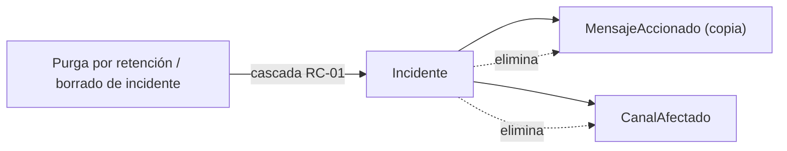

# Protección de datos personales (Ley 25.326)

> Tratamiento de datos personales de la solución **Administrador de Bots Moderador para Discord** y
> los controles que lo protegen. Base de decisión: **ADR-06 (Ley 25.326)**. Glosario:
> [`../../GLOSSARY.md`](../../GLOSSARY.md). **Este documento no contiene PII**: todos los ejemplos
> usan identificadores seudonimizados.

## Marco y base de la decisión

- El marco legal local aplicable es la **Ley argentina 25.326** de Protección de Datos Personales
  (autoridad de aplicación: AAIP), adoptada como **restricción transversal de diseño** en
  [ADR-06](../../../../Discord.Bot.Moderador.Core/SDD2.2D/docs/05_arquitectura_tecnica/adrs/ADR-06-compliance-ley-25326-proteccion-datos_v1.0.md).
- La solución **no** activa un perfil de dominio regulado formal (`docs-manifest.yaml`:
  `regulated: false`); ADR-06 se documenta como consideración de seguridad/retención.
- Principios aplicados por ADR-06: **residencia local** (los datos no salen del dispositivo del
  cliente, sin terceros), **minimización** (solo lo necesario) y **retención acotada**.

## Datos personales tratados

| Dato | Naturaleza | Dónde se persiste | Propósito | Traza |
|---|---|---|---|---|
| **Snowflake de usuario emisor** | Identificador de persona en Discord | Base SQLite (texto) | Registrar el sujeto del incidente para revisión | RN-08, RN-11; CU-05/06 |
| **Copia de mensajes accionados** | Contenido generado por el usuario (evidencia) | Base SQLite (texto) | Evidencia auditable de la acción, tomada antes de remover | RN-11; CU-05/06 |
| **Snowflakes de canales afectados** | Identificadores de canal | Base SQLite (texto) | Contexto del incidente | RN-11 |
| **Snowflake de servidor (guild)** | Identificador del contexto | Base SQLite (texto) | Identifica el contexto multi-contexto | RN-08; ADR-13 |
| **Identificador y contraseña del administrador** | Credencial del operador | Base SQLite (**hash PBKDF2**) | Autenticación del panel | RN-13, ADR-03 |

> **No se trata** contenido de mensajes fuera del incidente, ni se exportan datos a terceros
> (ADR-06 §2). El **token de bot** no es dato personal pero es secreto crítico: ver más abajo.

## Seudonimización en ejemplos (obligatoria)

En toda la documentación de este set, los snowflakes se representan con valores sintéticos, nunca
reales. Ejemplo de un incidente seudonimizado (mismo formato que el sembrado E2E del código):

| Campo | Valor de ejemplo (sintético) |
|---|---|
| Servidor (guild) | `100000000000000009` |
| Usuario emisor | `200000000000000002` |
| Canales afectados | `300000000000000001`, `300000000000000002` |
| Mensaje accionado | `"mensaje de ráfaga 1 (e2e)"` |

## Minimización y retención

- **Minimización**: la persistencia guarda **solo** los identificadores requeridos (snowflakes como
  texto) y la copia de mensajes estrictamente necesaria para la revisión (ADR-06 §7, RN-11). No se
  guarda historial de mensajes no accionados.
- **Retención acotada de la evidencia**: ADR-06 define una **política de retención** (ventana de
  conservación) y un **mecanismo de purga** de la evidencia antigua; la evidencia purgada deja de
  estar disponible para revisión (trade-off aceptado, ADR-06 §6). El detalle operativo de la
  ventana y la purga se trabaja en operaciones/DevOps (ver [`../07-operations/README.md`](../07-operations/README.md)).
- **Borrado en cascada**: al eliminar un incidente se eliminan sus dependientes (mensajes copiados y
  canales afectados), preservando la integridad referencial del modelo (RC-01, integridad de
  dependientes). No quedan copias de mensajes huérfanas.

## Secretos: nunca en claro

- **Token de bot**: cifrado en reposo con **AES-GCM**; la **clave maestra**
  (`DISCORDMODERADOR_CLAVE_MAESTRA`) vive fuera de la base, en el archivo de entorno con permisos
  `600`. El token se descifra **solo en memoria** para operar y nunca se registra en logs
  (ADR-07, RN-14, RC-07). Una copia de la base por sí sola **no** expone los tokens.
- **Clave maestra y token**: nunca se versionan en el repositorio (`.gitignore` ignora `*.env`;
  solo se versiona la plantilla) ni aparecen en logs (verificado en `SMOKE-TEST-DISCORD.md §8`).
- **Contraseña del administrador**: solo se maneja para derivar o verificar el hash; nunca se
  loguea ni se persiste en claro (ADR-03, RN-13).

## Riesgos y postura (resumen)

| Aspecto | Postura |
|---|---|
| Base SQLite sin cifrado a nivel archivo | La evidencia está en claro en el archivo; mitigada por residencia local, minimización, retención acotada y permisos del SO (ver [`threat-model.md`](threat-model.md) R2) |
| Transferencia a terceros | **Cero**; residencia local sin servicios externos (ADR-06 §8) |
| Pérdida de la clave maestra | No expone datos personales; inutiliza los tokens (procedimiento RB-03) |

## Referencias

- Decisión de compliance: [ADR-06](../../../../Discord.Bot.Moderador.Core/SDD2.2D/docs/05_arquitectura_tecnica/adrs/ADR-06-compliance-ley-25326-proteccion-datos_v1.0.md)
- Cifrado del token: [ADR-07](../../../../Discord.Bot.Moderador.Core/SDD2.2D/docs/05_arquitectura_tecnica/adrs/ADR-07-cifrado-tokens-reposo-clave-maestra_v1.0.md); hash: ADR-03
- Integridad de la evidencia: RN-11 (`../../../../Discord.Bot.Moderador.Core/SDD2.2D/docs/02_especificacion_funcional/reglas-de-negocio/RN-11-integridad-del-incidente_v1.0.md`)
- Modelo de amenazas: [`threat-model.md`](threat-model.md)
- Operación de la clave maestra y backup: [`../07-operations/README.md`](../07-operations/README.md)
