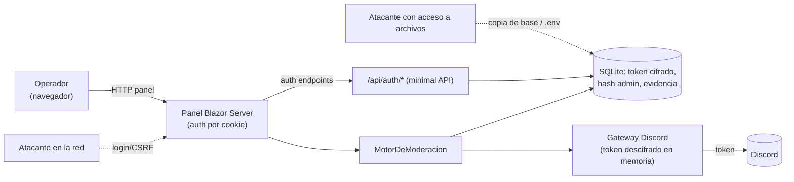

# Modelo de amenazas (STRIDE ligero)

> Modelo de amenazas de la solución **Administrador de Bots Moderador para Discord**, verificado
> contra el código (`Program.cs`, `Infraestructura/Seguridad/`, `Dominio/Administracion/`). Glosario:
> [`../../GLOSSARY.md`](../../GLOSSARY.md). Los controles se **referencian** a ADR/RN; la fuente
> autoritativa de las decisiones es la SDD 2.2.

## Alcance y supuestos

- La pieza es un **monolito auto-hospedado de un único operador** (ADR-01, ADR-11): no expone API ni
  superficie pública a terceros; la **única superficie de red es el panel de administración**.
- El panel se sirve por **HTTP** en el dispositivo (`ASPNETCORE_URLS=http://127.0.0.1:5080` en la
  plantilla de entorno), sin certificado propio (ADR-05); se expone solo en la red del operador.
- El adversario relevante: quien acceda a la red del panel, quien obtenga una copia de la base o del
  archivo de entorno, o quien intente forzar el login. No se modela un atacante con root persistente
  en el dispositivo (fuera de alcance: se asume el SO endurecido por el operador).

## Activos a proteger

| Activo | Dónde vive | Confidencialidad | Integridad |
|---|---|---|---|
| **Token de bot** (por servidor) | Base SQLite, **cifrado AES-GCM** (nunca en claro) | Crítica | Alta |
| **Clave maestra** de cifrado | Variable de entorno / archivo `.env` (fuera de la base) | Crítica | Alta |
| **Credencial del administrador** | Base SQLite, **hash PBKDF2 (PHC)** | Crítica | Alta |
| **Cookie de sesión** del administrador | Navegador del operador | Alta | Alta |
| **Evidencia de incidentes** (copias de mensajes, canales, snowflakes) | Base SQLite | Media (datos personales, ADR-06) | Alta |
| **Configuración de moderación** (reglas, exenciones, políticas) | Base SQLite | Media | Alta |

## Superficie de ataque

Superficies: (1) el **panel HTTP autenticado**; (2) los **endpoints de auth** `/api/auth/*`
(login, first-run, logout, cambio de contraseña); (3) el **token en reposo** y la clave maestra;
(4) la **base local**; (5) la **cadena de suministro** del paquete/dependencias.

## Amenazas → controles (STRIDE ligero)

| # | Categoría STRIDE | Amenaza | Control existente (verificado) | Traza |
|---|---|---|---|---|
| T1 | **Spoofing** | Suplantar al administrador sin credenciales | Autenticación por cookie con esquema único rol `administrador`; sign-in solo tras verificar credenciales | `Program.cs` (AddCookie, /api/auth/ingresar); ADR-03, RN-12 |
| T2 | **Spoofing** | Fuerza bruta / relleno de credenciales en el login | **Control de intentos**: bloqueo temporal tras 5 fallos en 15 min, enfriamiento 15 min; clave = usuario+IP; sin enumeración de cuentas (mensaje neutro) | `ControlIntentosAutenticacion.cs`; `Program.cs` (ClaveIntentos); CU-09 |
| T3 | **Tampering** | CSRF sobre los POST de auth (login/first-run/logout/cambio) | **Antiforgery** validado en cada POST; cookie de sesión y de token con `SameSite=Strict` | `Program.cs` (AddAntiforgery, EsRequestValidaAsync); ADR-03 |
| T4 | **Tampering** | Robo de la cookie de sesión vía XSS | Cookie `HttpOnly` (no accesible desde JS) + `SameSite=Strict`; vencimiento de sesión (8 h, sliding) | `Program.cs` (Cookie.HttpOnly/SameSite/ExpireTimeSpan) |
| T5 | **Info disclosure** | Lectura del token de bot desde una copia de la base | **Cifrado AES-GCM** del token en reposo; clave maestra fuera de la base; descifrado solo en memoria al operar | `ServicioCifradoAes.cs`; ADR-07, RN-14, RC-07 |
| T6 | **Info disclosure** | Recuperar la contraseña del admin desde la base | **Hash PBKDF2-HMAC-SHA256** (210 000 iter., salt de 16 B, formato PHC) con comparación de tiempo constante | `ServicioHashContrasenaPbkdf2.cs`; ADR-03, RN-13 |
| T7 | **Info disclosure** | Enumeración de cuentas por mensajes/tiempos del login | Mensaje de error neutro (no distingue qué campo falló); clave de intentos opaca; verificación de tiempo constante | `Program.cs` (AUTH_CREDENCIALES_INVALIDAS); CU-09, RN-13 |
| T8 | **DoS** | Expresión regular maliciosa (ReDoS) en reglas de contenido | Patrones **validados al guardar** (RN-03) y evaluación con **tope de tiempo** anti-ReDoS | ADR-08, RN-03; `Dominio/Contenido/` |
| T9 | **DoS** | Superficie de endpoints de prueba en producción | Endpoints `/e2e/seed/*` se montan **solo** en entorno `E2E`; en dev/producción no existen | `Program.cs` (IsEnvironment("E2E")) |
| T10 | **Elevation** | Acción de moderación abusiva o sobre un objetivo protegido | Jerarquía de roles: no acciona sobre rol superior/igual ni sin permiso; incidente **no accionable** registrado, el bot no se cae | ADR-08, RN-01; `MotorDeModeracion.cs` |
| T11 | **Elevation** | Acceso a funciones administrativas sin sesión | Autorización por rol único; `/api/auth/cambiar-contrasena` con `RequireAuthorization`; gating auth antes del ruteo | `Program.cs` (UseAuthentication/Authorization); RN-12 |
| T12 | **Repudiation** | Falta de evidencia de una acción de moderación | **Integridad del incidente**: copia de mensajes y canales tomada antes de remover; logs al journal del sistema | RN-11, ADR-08; `discord-moderador-bot.service` (journal) |
| T13 | **Tampering** (supply chain) | Dependencia vulnerable / artefacto adulterado | SQLitePCLRaw parcheado forzado (ver riesgo residual R5); SBOM + firma del paquete y verificación de checksum antes de instalar | `.csproj` (NU1903 / GHSA-2m69-gcr7-jv3q); `supply-chain-seguridad_v1.0.md` |

## Riesgos residuales

| # | Riesgo residual | Impacto | Mitigación / postura actual |
|---|---|---|---|
| R1 | **Panel por HTTP sin TLS por defecto** (ADR-05): credenciales y cookie viajan en claro si el panel se expone fuera de `localhost` sin proxy TLS | Alto si se expone en red no confiable | `CookieSecurePolicy.SameAsRequest` activa `Secure` automáticamente **si** hay HTTPS (p. ej. detrás de un proxy TLS); recomendación operativa: exponer solo en `127.0.0.1` o tras un proxy TLS |
| R2 | **Base SQLite sin cifrado a nivel archivo**: la evidencia de incidentes y la configuración están en claro en el archivo (solo el token está cifrado) | Medio (datos personales, ADR-06) | Residencia local, minimización y retención acotada (ADR-06); permisos del SO; `ReadWritePaths` acotado en systemd |
| R3 | **Clave maestra de desarrollo determinista** si `DISCORDMODERADOR_CLAVE_MAESTRA` no se define: en producción el cifrado sería trivial de revertir | Crítico si se omite en producción | La clave es **obligatoria** en producción (ADR-07); documentado en la plantilla `.env` y en el instalador; ver [`data-protection.md`](data-protection.md) y RB-03 |
| R4 | **Pérdida de la clave maestra** inutiliza los tokens cifrados | Operativo (no de confidencialidad) | Resguardo fuera del dispositivo (RB-03); el rollback preserva el `.env` |
| R5 | Vulnerabilidad de cadena de suministro no detectada a tiempo | Variable | Dependency scanning + política de CVE por severidad (`supply-chain-seguridad_v1.0.md §4/§6`); SBOM y firma |

## Referencias

- Protección de datos personales y retención: [`data-protection.md`](data-protection.md)
- Decisiones de seguridad: ADR-03, ADR-06, ADR-07, ADR-08 en
  [`../04-decisions/README.md`](../04-decisions/README.md)
- Supply chain (fuente): `../../../../Discord.Bot.Moderador.Core/SDD2.2D/docs/09_devops/supply-chain-seguridad_v1.0.md`
- Operación de secretos y clave maestra: [`../07-operations/README.md`](../07-operations/README.md) (RB-03)
