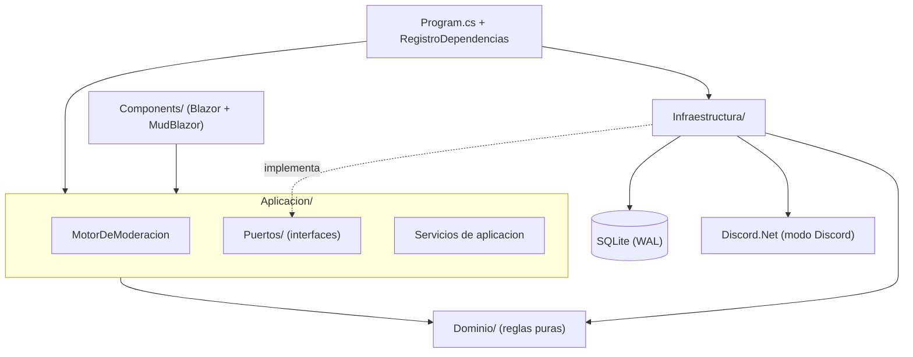

# Pieza `DiscordModeradorBot.Servicio`

## Qué es

`DiscordModeradorBot.Servicio` es el proyecto único (tipo `web-monolith`) de la solución
**Administrador de Bots Moderador para Discord** (`Discord.Bot.Moderador.Core`). Reúne en un
solo proceso auto-hospedable tres responsabilidades:

- **Panel de administración** (Blazor Server interactivo + MudBlazor): alta del administrador,
  registro de servidores, configuración de moderación, exenciones y revisión de incidentes.
- **Bot de moderación** (servicio en segundo plano): detecta el patrón de *ráfaga distribuida*
  (un usuario que publica en varios canales distintos dentro de una ventana corta) y reglas de
  contenido, y actúa sobre el emisor (baneo con borrado retroactivo, timeout, expulsión, roles),
  reportando a un canal privado.
- **Persistencia** (EF Core + SQLite en modo WAL): incidentes, servidores registrados,
  configuración normalizada, exenciones y credenciales del administrador.

Está pensado para auto-hospedarse en una Raspberry Pi (publicación self-contained `linux-arm`,
servicio systemd) y también se distribuye como imagen Docker x64.

> Términos como *ráfaga distribuida*, *antirrebote*, *incidente*, *modo simulación* y *gateway*
> están definidos en el [glosario canónico](../../../GLOSSARY.md).

## Dependencias con versiones

Fuente: `src/DiscordModeradorBot.Servicio/DiscordModeradorBot.Servicio.csproj` y
`Directory.Build.props`.

| Componente | Versión | Rol |
| --- | --- | --- |
| .NET / `net10.0` | 10.0 (SDK 10.0.300 vía `global.json`) | Runtime y target framework |
| Discord.Net | 3.20.1 | Gateway en tiempo real + API REST de Discord (modo `Discord`) |
| MudBlazor | 9.5.0 | Componentes del panel Blazor Server |
| Microsoft.EntityFrameworkCore.Sqlite | 10.0.9 | Persistencia SQLite (WAL) |
| Microsoft.EntityFrameworkCore.Design | 10.0.9 | Migraciones (privado, no transitivo) |
| SQLitePCLRaw.bundle_e_sqlite3 | 3.0.3 | Nativa SQLite parcheada (mitiga GHSA-2m69-gcr7-jv3q) |
| SQLitePCLRaw.lib.e_sqlite3 | 3.50.3 | Fuerza SQLite 3.50.x sin la vulnerabilidad alta |
| Nerdbank.GitVersioning | 3.10.85 | Versionado SemVer derivado de Git (`version.json` = 1.0, sin tags) |

El pin directo de `SQLitePCLRaw.*` sobrescribe la versión transitiva vulnerable para cumplir el
quality gate de 0 vulnerabilidades altas (ver comentario en el `.csproj` y `SUPPLY-CHAIN-NOTE.md`
del repo).

## Cómo se corre

### Compilar

```bash
dotnet build
```

### Ejecutar localmente (modo Simulado)

```bash
dotnet run --project src/DiscordModeradorBot.Servicio
```

Por defecto arranca con el gateway en modo **Simulado** (sin red ni token): aplica las
migraciones, activa WAL, levanta el panel y un servicio que inyecta escenarios de demostración.
Páginas relevantes: `/incidentes`, `/servidores`, `/configuracion`, `/exenciones`, first-run del
administrador en `/configuracion-inicial` e ingreso en `/ingresar`. El detalle del arranque en
modo Discord está en [`developer-setup.md`](../../08-onboarding/developer-setup.md).

### Probar

```bash
# Unit + integración (sin red ni navegador)
dotnet test DiscordModeradorBot.slnx

# Cobertura con umbrales (global líneas >= 75% / branches >= 65%; detección >= 90%)
dotnet test --settings coverlet.runsettings --results-directory TestResults
pwsh scripts/ci/verificar-cobertura.ps1
```

Los e2e de Playwright viven fuera de la solución; ver [`developer-setup.md`](../../08-onboarding/developer-setup.md).

## Estructura de capas (Clean Architecture)

La pieza organiza el código en capas con dependencias hacia el dominio (ADR-01, ADR-04). El
código es la fuente de verdad; la visión de la solución completa está en
[`docs/01-architecture/01-context.md`](../../01-architecture/01-context.md).

| Capa | Carpeta | Responsabilidad |
| --- | --- | --- |
| Dominio | `Dominio/` | Reglas puras: evaluadores de ráfaga/contenido/exenciones, descriptores de parámetro, entidades de moderación, `Snowflake`. Sin dependencias de infraestructura. |
| Aplicación | `Aplicacion/` | Orquestación: `MotorDeModeracion` (pipeline), servicios de registro/exenciones/configuración/administrador, y los **puertos** (`Aplicacion/Puertos/`). |
| Infraestructura | `Infraestructura/` | Adaptadores: gateway (Discord/Simulado), persistencia EF Core, seguridad (AES/PBKDF2), servicios en segundo plano, composición DI. |
| Presentación | `Components/`, `Theme/` | Panel Blazor Server + MudBlazor (páginas y componentes). |



## Documentos de la pieza

- [`architecture-local.md`](./architecture-local.md) — C4-L3 local, puertos/adaptadores, decisiones locales.
- [`configuration.md`](./configuration.md) — claves de configuración, variables de entorno y descriptores de parámetro.
- [`snippets.md`](./snippets.md) — corpus curado de snippets con procedencia.
- [`CHANGELOG.md`](./CHANGELOG.md) — historial reconstruido (Keep a Changelog).

## Enlaces a nivel solución

- [Visión](../../00-overview/vision.md) · [Mapa del sistema](../../00-overview/system-map.md) · [Contexto/arquitectura](../../01-architecture/01-context.md)
- [Catálogo de APIs](../../05-apis/catalog.md) · [Setup del desarrollador](../../08-onboarding/developer-setup.md)
- Documentación SDD 2.2 del repo (secundaria): `SDD2.2D/docs/05_arquitectura_tecnica/` (arquitectura, extensibilidad, flujo de ejecución).

## Owner y estado

- **Owner:** equipo-discordmoderador (propuesto).
- **Estado:** v1 funcionalmente completo — los 16 casos de uso del intake implementados en siete
  rebanadas verticales (R1..R7), integración real con Discord.Net, CI/CD con quality gates,
  endurecimiento de seguridad y pruebas e2e (ver [CHANGELOG](./CHANGELOG.md)).
</content>
</invoke>
