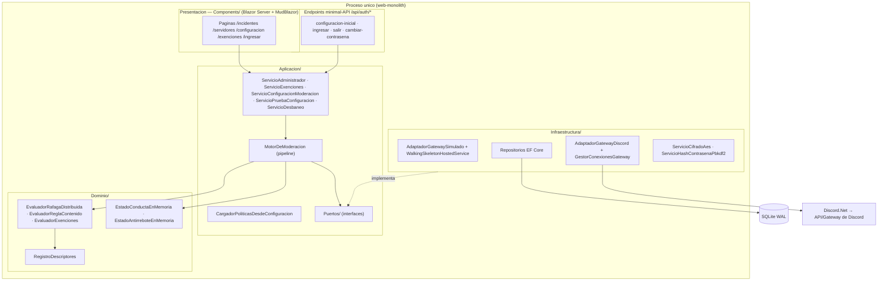

# Arquitectura local — `DiscordModeradorBot.Servicio`

Este documento describe la estructura **interna** de la pieza (nivel C4-L3, componentes) y sus
decisiones locales. La arquitectura de la solución completa (contexto, contenedores) no se
duplica aquí: ver [`docs/01-architecture/01-context.md`](../../01-architecture/01-context.md) y,
como fuente secundaria, `SDD2.2D/docs/05_arquitectura_tecnica/arquitectura-solucion_v1.0.md`.

## Vista de componentes (C4-L3)

## Puertos y adaptadores

La capa de Aplicación define **puertos** (interfaces en `Aplicacion/Puertos/`) que la
Infraestructura implementa. La composición se resuelve en
[`RegistroDependencias.AgregarServiciosModeracion`](../../pieces/discordmoderadorbot-servicio/snippets.md).

| Puerto (`Aplicacion/Puertos/`) | Implementación (`Infraestructura/`) | Ciclo de vida |
| --- | --- | --- |
| `IAdaptadorGateway` | `AdaptadorGatewaySimulado` **o** `AdaptadorGatewayDiscord` (según `Moderacion:Gateway`) | Singleton |
| `IFabricaClienteGateway` / `IClienteGatewayServidor` | `AdaptadorGatewayDiscord` / `ClienteGatewayServidorDiscord` (solo modo Discord) | Singleton / transient por servidor |
| `IEstadoConexionGateway` | `Gateway/EstadoConexionGatewayEnMemoria` | Singleton |
| `IReloj` | `RelojDelSistema` | Singleton |
| `IServicioCifrado` | `Seguridad/ServicioCifradoAes` | Singleton |
| `IServicioHashContrasena` | `Seguridad/ServicioHashContrasenaPbkdf2` | Singleton |
| `IRepositorioServidores` | `Persistencia/RepositorioServidores` | Scoped |
| `IRepositorioIncidentes` | `Persistencia/RepositorioIncidentes` | Scoped |
| `IRepositorioReglasContenido` | `Persistencia/RepositorioReglasContenido` | Scoped |
| `IRepositorioExenciones` | `Persistencia/RepositorioExenciones` | Scoped |
| `IRepositorioConfiguracion` | `Persistencia/RepositorioConfiguracion` | Scoped |
| `IRepositorioAdministrador` | `Persistencia/RepositorioAdministrador` | Scoped |
| `ICargadorPoliticas` (en `Aplicacion/`) | `CargadorPoliticasDesdeConfiguracion` | Scoped |

> El puerto `IReloj` existe para hacer determinista la evaluación de ventanas y desacoplar los
> tests del tiempo real (ADR-09). Los puertos de repositorio siguen el patrón Repository sobre
> `ContextoPersistencia` (EF Core).

## Pipeline del `MotorDeModeracion`

`MotorDeModeracion.ProcesarAsync` orquesta las etapas del flujo de ejecución (ver
`SDD2.2D/docs/05_arquitectura_tecnica/flujo-ejecucion_v1.0.md`). El fragmento con procedencia está
en [`snippets.md`](./snippets.md#a-uso-canonico-del-pipeline).

```mermaid
flowchart LR
    E1["1. Descarte de exentos (RN-07)"] --> E2["2. Reglas de contenido (CU-04)"]
    E2 --> E3["3. Estado de conducta"]
    E3 --> E4["4. Evaluacion de politicas por prioridad (RN-04)"]
    E4 --> E6["6. Decision de modo (RN-09)"]
    E6 --> E7["7. Antirrebote por usuario (RN-06)"]
    E7 --> E5["5. Copia de mensajes (RN-11)"]
    E5 --> E8["8. Ejecucion de acciones en orden (RN-05)"]
    E8 --> E9["9. Registro del incidente"]
```

## Decisiones locales

- **Selección de gateway por configuración (ADR-13).** `Moderacion:Gateway` (`Simulado` |
  `Discord`) decide qué adaptador y qué servicio en segundo plano se registran. `Simulado`
  (default) registra `AdaptadorGatewaySimulado` + `WalkingSkeletonHostedService` (sin red ni
  token); `Discord` registra `AdaptadorGatewayDiscord` + `GestorConexionesGateway`
  (`GestorConexionesGatewayHostedService`), que abre una conexión por servidor activo con su token
  descifrado. Ver `Infraestructura/Gateway/ModoGateway.cs`.
- **Composición centralizada en `RegistroDependencias`.** Toda la DI de las tres capas se resuelve
  en un único método de extensión invocado desde `Program.cs`, manteniendo `Program.cs` centrado
  en el bootstrap del host web, auth y endpoints.
- **Políticas dirigidas por configuración (CU-11).** No hay política hardcodeada: `MotorDeModeracion`
  carga las políticas del servidor vía `ICargadorPoliticas` en cada mensaje, de modo que la
  configuración persistida del panel dirige la moderación. Un constructor de compatibilidad acepta
  una lista fija de políticas para tests y walking skeleton.
- **SQLite en modo WAL (ADR-02).** `Program.cs` aplica `Database.Migrate()` y ejecuta
  `PRAGMA journal_mode=WAL;` al arranque para tolerar escrituras concurrentes bot/panel. La ruta
  del archivo es configurable por `Persistencia:RutaBase` (default: junto al ejecutable).
- **Estado efímero en memoria (ADR-09).** `EstadoConductaEnMemoria`, `EstadoAntirreboteEnMemoria` y
  `ControlIntentosAutenticacion` son singletons no persistidos: la ventana deslizante de conducta,
  el antirrebote por usuario y el control de intentos de login viven solo en memoria.
- **Seguridad de sesión.** Autenticación por cookie del administrador único con
  `HttpOnly` + `SameSite=Strict` + `SecurePolicy=SameAsRequest` (el panel se sirve por HTTP en el
  dispositivo, ADR-05), antiforgery en todos los POST de auth, hashing PBKDF2 en formato PHC
  (ADR-03) y cifrado AES de tokens en reposo con la clave maestra (ADR-07). Detalle en
  [`configuration.md`](./configuration.md).

## Referencias

- Fuente de verdad: código de la pieza (`src/DiscordModeradorBot.Servicio/`).
- Solución: [`docs/01-architecture/01-context.md`](../../01-architecture/01-context.md).
- SDD 2.2 (secundaria): `SDD2.2D/docs/05_arquitectura_tecnica/` (arquitectura, extensibilidad, flujo de ejecución, ADR).
- Glosario: [`GLOSSARY.md`](../../../GLOSSARY.md).
</content>
</invoke>
