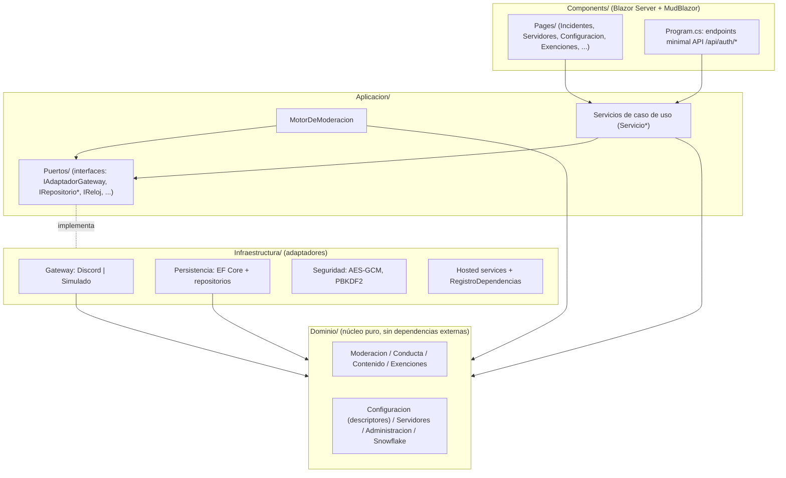

# 00 · Master Index

> **Propósito.** Visión general del proyecto `DiscordModeradorBot.Servicio`: qué es, stack, decisiones
> de arquitectura (ADRs), mapa de capas Clean y ruta de lectura recomendada. Punto de partida antes
> de bajar a un índice temático. **Fuente primaria:** `src/DiscordModeradorBot.Servicio/`,
> `DiscordModeradorBot.slnx`, `Directory.Build.props`; ADRs en `SDD2.2D/docs/05_arquitectura_tecnica/adrs/`.

## Qué es

Monolito modular .NET 10 que reúne **en un solo proceso** tres responsabilidades:

1. **Bot de moderación** — un `IHostedService` en segundo plano recibe los mensajes de Discord y los
   pasa por el `MotorDeModeracion` (pipeline de 9 etapas, ver `01_arquitectura-y-pipeline.md`).
2. **Panel de administración** — Blazor Server interactivo (MudBlazor) para registrar servidores,
   configurar políticas, revisar incidentes y gestionar exenciones (ver `05_panel-web.md`).
3. **Persistencia** — SQLite en modo WAL vía EF Core (13 tablas, ver `06_modelo-de-datos.md`).

Solución `Administrador de Bots Moderador para Discord`, **proyecto único** (`DiscordModeradorBot.slnx`).
El proyecto e2e queda deliberadamente **fuera** de la solución.

## Stack tecnológico

| Componente | Tecnología | Traza |
|---|---|---|
| Runtime / lenguaje | .NET 10 / C# (Nullable + ImplicitUsings) | `src/.../DiscordModeradorBot.Servicio.csproj` |
| UI | Blazor Server interactivo (`AddInteractiveServerComponents`) + MudBlazor 9.5.0 | `Program.cs`, csproj |
| Plataforma Discord | Discord.Net 3.20.1 | csproj |
| Persistencia | EF Core 10 (`Microsoft.EntityFrameworkCore.Sqlite` 10.0.9) sobre SQLite (WAL) | csproj, `Program.cs` |
| SQLite nativo | `SQLitePCLRaw.bundle_e_sqlite3` 3.0.3 + `lib.e_sqlite3` 3.50.3 (fix supply-chain GHSA-2m69-gcr7-jv3q) | csproj |
| Versionado | Nerdbank.GitVersioning 3.10.85 (`version.json` = 1.0) | `Directory.Build.props`, `version.json` |
| Análisis estático | .NET analyzers, `AnalysisMode=Default`, `-warnaserror` en CI | `Directory.Build.props` |
| SDK fijado | `global.json` | raíz |

## Decisiones de arquitectura (ADRs)

Los ADRs viven en `SDD2.2D/docs/05_arquitectura_tecnica/adrs/` (v1.0). Se referencian por id en todo
el código y en estos índices.

| ADR | Decisión | Se materializa en (índice) |
|---|---|---|
| **ADR-01** | Estilo monolítico en capas con pipeline | 01 |
| **ADR-02** | Persistencia relacional embebida SQLite en modo WAL | 06 |
| **ADR-03** | Autenticación de administrador único con hash robusto (PBKDF2/PHC) | 09 |
| **ADR-04** | Separación de capas; dominio independiente; gateway simulado por defecto | 01, 04 |
| **ADR-05** | Despliegue self-contained ARM como servicio del sistema (systemd) | 08 |
| **ADR-06** | Compliance Ley 25.326 (protección de datos) | 09 (marcado, ver gap) |
| **ADR-07** | Cifrado de tokens en reposo con clave maestra (AES-GCM) | 09, 04 |
| **ADR-08** | Manejo de errores del pipeline por resultados de moderación (no excepciones) | 01, 03 |
| **ADR-09** | Estado de conducta y antirrebote **en memoria** (no persistido) | 02 |
| **ADR-10** | Omisión de contratos de prompts AI | — (proceso, no código) |
| **ADR-11** | Colapso de developer guide en READMEs | 08 |
| **ADR-12** | Configuración dirigida por esquema (descriptores) | 02, 09 |
| **ADR-13** | Dominio firewall multi-contexto (una conexión por servidor) | 04 |
| **ADR-14** | Despliegue en contenedor Docker x64 (Portainer) | 08 |

## Mapa de capas Clean

Regla de dependencia (ADR-04): `Dominio` no depende de nadie; `Aplicacion` depende de `Dominio` y
define `Puertos/`; `Infraestructura` implementa esos puertos; `Components/` consume `Aplicacion`. La
composición (wiring) vive en `Infraestructura/RegistroDependencias.cs` y `Program.cs`.

## Rebanadas verticales (R1..R7) y casos de uso

El producto se construyó en 7 rebanadas verticales, 16 casos de uso (CU-01..CU-16). Referencia:
`SDD2.2D/docs/07_plan-sprint/` y `SDD2.2D/docs/02_especificacion_funcional/casos-de-uso/`.

| Rebanada | Aporte central | CU asociados (aprox.) |
|---|---|---|
| R1 | Detección de ráfaga distribuida + reporte en simulación | CU-01, CU-14 |
| R2 | Ejecución real: baneo con borrado retroactivo + reporte a canal privado | CU-02, CU-03, CU-05 |
| R3 | Reglas de contenido sin estado (regex anti-ReDoS) | CU-04 |
| R4 | Detalle de incidente + reversión de baneo (desbaneo) | CU-06, CU-07 |
| R5 | Descarte previo de exentos (etapa 1) | CU-15 |
| R6 | Catálogo de acciones (timeout/expulsión/roles) + antirrebote + no accionable | CU-16, CU-02 §7 |
| R7 | Configuración normalizada (grupos/eventos/acciones) que dirige la moderación | CU-11, CU-12, CU-13 |

Autenticación del administrador (CU-08 first-run, CU-09 login) atraviesa varias rebanadas.

## Ruta de lectura recomendada

1. Este índice (visión general).
2. `01_arquitectura-y-pipeline.md` — cómo fluye un mensaje.
3. Según la tarea: `02_dominio.md` (reglas de negocio), `04_infraestructura.md` (adaptadores),
   `06_modelo-de-datos.md` (esquema), `09_configuracion-y-seguridad.md` (flags y secretos).

## Gaps / no verificado

- El nombre del repositorio remoto se toma de la unidad systemd (`scripts/servicio/discord-moderador-bot.service`),
  no de un `.git/config` accesible desde este índice.
- ADR-06 (Ley 25.326) y ADR-10/ADR-11 son decisiones de proceso/compliance sin materialización directa
  verificable en el código escaneado; se listan pero no se detallan.
</content>
