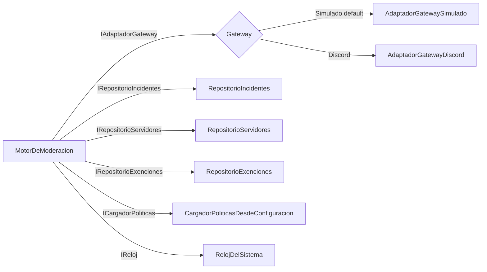
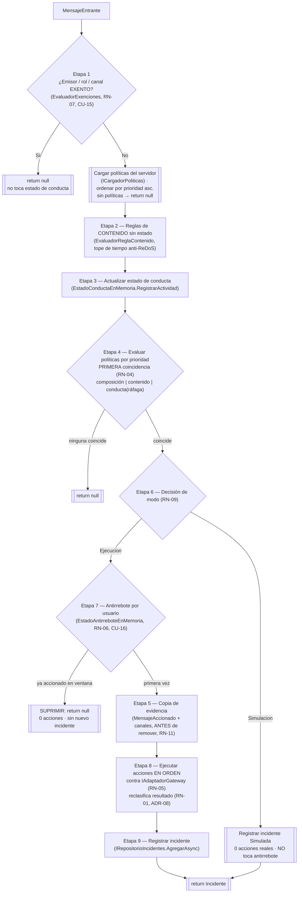
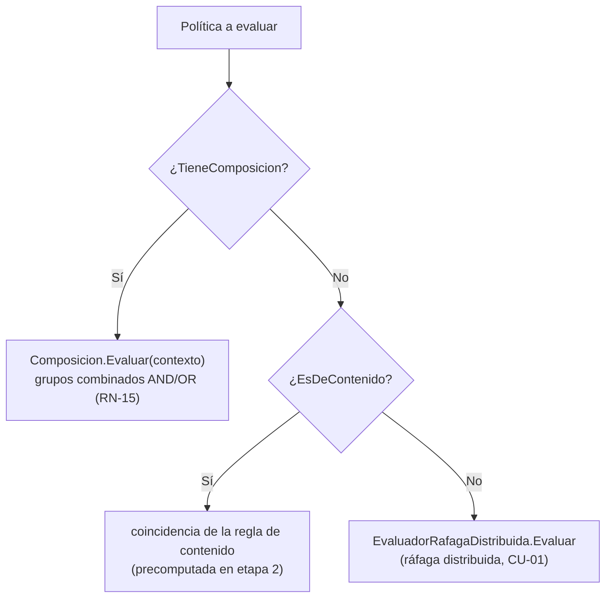

# 01 · Arquitectura y pipeline de moderación

> **Propósito.** Explicar la arquitectura Clean por capas, la composición de dependencias y el
> **pipeline de 9 etapas** que ejecuta el `MotorDeModeracion` sobre cada mensaje entrante, incluyendo
> puertos y adaptadores. **Fuente primaria:** `src/DiscordModeradorBot.Servicio/Aplicacion/MotorDeModeracion.cs`,
> `Infraestructura/RegistroDependencias.cs`, `Program.cs`. ADR-01, ADR-04, ADR-08, ADR-13.

## Capas y regla de dependencia

Ver el mapa de capas en [`00_MASTER-INDEX.md`](00_MASTER-INDEX.md#mapa-de-capas-clean). El detalle
por capa está en los índices `02` (dominio), `03` (aplicación), `04` (infraestructura) y `05` (panel).

| Capa | Carpeta | Rol | Depende de |
|---|---|---|---|
| Dominio | `Dominio/` | Reglas de negocio puras, sin frameworks | nada |
| Aplicación | `Aplicacion/` | Orquestación (motor + servicios) y `Puertos/` (interfaces) | Dominio |
| Infraestructura | `Infraestructura/` | Adaptadores concretos de los puertos | Dominio, Aplicación |
| Presentación | `Components/` + `Program.cs` | Panel Blazor y endpoints de auth | Aplicación |

## Puertos y adaptadores

Los puertos son interfaces en `Aplicacion/Puertos/`; los adaptadores los implementan en
`Infraestructura/`. Selección del adaptador de gateway por flag `Moderacion:Gateway` (ver `04` y `09`).

| Puerto (`Aplicacion/Puertos/`) | Adaptador (Infraestructura) | Propósito |
|---|---|---|
| `IAdaptadorGateway` | `AdaptadorGatewayDiscord` / `AdaptadorGatewaySimulado` | Ejecutar acciones y recibir mensajes |
| `IClienteGatewayServidor` / `IFabricaClienteGateway` | `ClienteGatewayServidorDiscord` / `AdaptadorGatewayDiscord` | Conexión por servidor (ADR-13) |
| `IEstadoConexionGateway` | `EstadoConexionGatewayEnMemoria` | Estado de conexión por servidor (CU-13) |
| `IRepositorioServidores/Incidentes/ReglasContenido/Administrador/Exenciones/Configuracion` | `Repositorio*` (EF) | Persistencia |
| `IReloj` | `RelojDelSistema` | Tiempo inyectable (tests deterministas) |
| `IServicioCifrado` | `ServicioCifradoAes` | Cifrado de tokens (ADR-07) |
| `IServicioHashContrasena` | `ServicioHashContrasenaPbkdf2` | Hash de contraseña (ADR-03) |
| `ICargadorPoliticas` (en `Aplicacion/`) | `CargadorPoliticasDesdeConfiguracion` | Materializa la config del panel a políticas de dominio |

## Composición de dependencias

`Infraestructura/RegistroDependencias.cs` → método de extensión `AgregarServiciosModeracion(cadenaConexion, modoGateway)`,
invocado desde `Program.cs`. Puntos clave:

- **DbContext** `ContextoPersistencia` con `UseSqlite`; el `PRAGMA journal_mode=WAL` se aplica al
  arrancar en `Program.cs` tras `Database.Migrate()`.
- **Singletons** (estado/servicios transversales): `IReloj`, `IServicioCifrado`, `IServicioHashContrasena`,
  `ControlIntentosAutenticacion`, `IEstadoConexionGateway`, y el estado en memoria del dominio
  (`EstadoConductaEnMemoria`, `EstadoAntirreboteEnMemoria`, evaluadores).
- **Scoped**: repositorios EF, `MotorDeModeracion`, servicios de caso de uso, `ICargadorPoliticas`
  (depende de repositorios scoped).
- **Selección de gateway** (ADR-13): si `Moderacion:Gateway = Discord` registra `AdaptadorGatewayDiscord`
  + `GestorConexionesGateway` + `GestorConexionesGatewayHostedService`; si no (default `Simulado`),
  registra `AdaptadorGatewaySimulado` + `WalkingSkeletonHostedService`.

## Pipeline de moderación de 9 etapas

Entrada: `MotorDeModeracion.ProcesarAsync(MensajeEntrante, ct)`
(`Aplicacion/MotorDeModeracion.cs`). Devuelve el `Incidente` generado o `null` si nada coincidió. El
orden y la semántica de cada etapa están codificados en ese método.

> Nota de numeración: el método ejecuta las etapas en el orden 1→2→3→4 y, dentro de la aplicación de
> una política coincidente (`AplicarPoliticaAsync`), 6 (modo) → 7 (antirrebote) → 5 (copia) → 8
> (acciones) → 9 (registro). La numeración proviene del documento `flujo-ejecucion`; el modo se decide
> antes que la copia porque la simulación no debe tomar evidencia ni tocar el antirrebote.

### Detalle por etapa

| # | Etapa | Qué hace | Reglas |
|---|---|---|---|
| 1 | Descarte de exentos | Si usuario, alguno de sus roles o el canal están exentos → `null`, sin registrar actividad de conducta | RN-07, CU-15 |
| — | Carga de políticas | `ICargadorPoliticas.CargarAsync(servidorId)` ordenadas por `Prioridad` asc.; sin políticas → `null` | RN-04, CU-11 |
| 2 | Reglas de contenido | Evalúa cada política de contenido con tope de tiempo; exceso → no coincidencia registrada (no cuelga) | CU-04, ADR-08 |
| 3 | Estado de conducta | `RegistrarActividad(mensaje)` en la ventana deslizante en memoria | ADR-09 |
| 4 | Evaluación de políticas | Por prioridad, primera coincidencia. Forma: composición (grupos) > contenido directo > conducta (ráfaga). `Continuar=true` sigue evaluando | RN-04, RN-15 |
| 6 | Decisión de modo | `Simulacion`: registra `Simulada`, 0 acciones, no toca antirrebote. `Ejecucion`: sigue | RN-09 |
| 7 | Antirrebote | Si el usuario ya fue accionado dentro de la ventana → suprime (0 acciones, sin incidente) | RN-06, CU-16, ADR-09 |
| 5 | Copia de evidencia | Copia mensaje(s) y canales ANTES de remover; es la única evidencia que sobrevive al borrado | RN-11 |
| 8 | Ejecución de acciones | Ordena por `OrdenEjecucion`, ejecuta contra el adaptador; reclasifica incidente (`NoAccionable`/`Fallida`) sin caerse | RN-05, RN-01, ADR-08 |
| 9 | Registro | Persiste el incidente y marca al usuario en el antirrebote | RN-11 |

### Ejes de disparo de una política (etapa 4)

El detalle de composición, grupos y modos de coincidencia está en [`02_dominio.md`](02_dominio.md).

## Manejo de errores del pipeline (ADR-08, RN-01)

- El pipeline **no propaga excepciones** por fallos de plataforma o de moderación: los mapea a un
  `ResultadoModeracion`.
- Una acción de contención que no se aplica por jerarquía/permisos deja el incidente en
  `NoAccionable`; un rechazo de plataforma lo deja en `Fallida`. En ambos casos el incidente **se
  registra y se reporta igual** (`PeorResultado` conserva el más severo).
- Una regex de contenido que excede el tope se trata como no coincidencia (`ExcedioTope`), sin colgar
  el flujo (anti-ReDoS).
- Configuración incompleta (grupo sin reglas, evento sin grupos) se **omite** en el cargador sin
  tumbar el resto (`CargadorPoliticasDesdeConfiguracion`).

## Recepción de mensajes (entrada del pipeline)

- **Modo Simulado**: `WalkingSkeletonHostedService` inyecta escenarios de demostración (ráfaga,
  ejecución, contenido, exención) al adaptador simulado.
- **Modo Discord**: `GestorConexionesGatewayHostedService` abre una conexión por servidor activo;
  cada mensaje se mapea con `MapeadorMensajeGremio` (descarta DM, bots y mensajes de sistema) y se
  enruta al `MotorDeModeracion` en un scope por mensaje. Ver [`04_infraestructura.md`](04_infraestructura.md).
</content>
