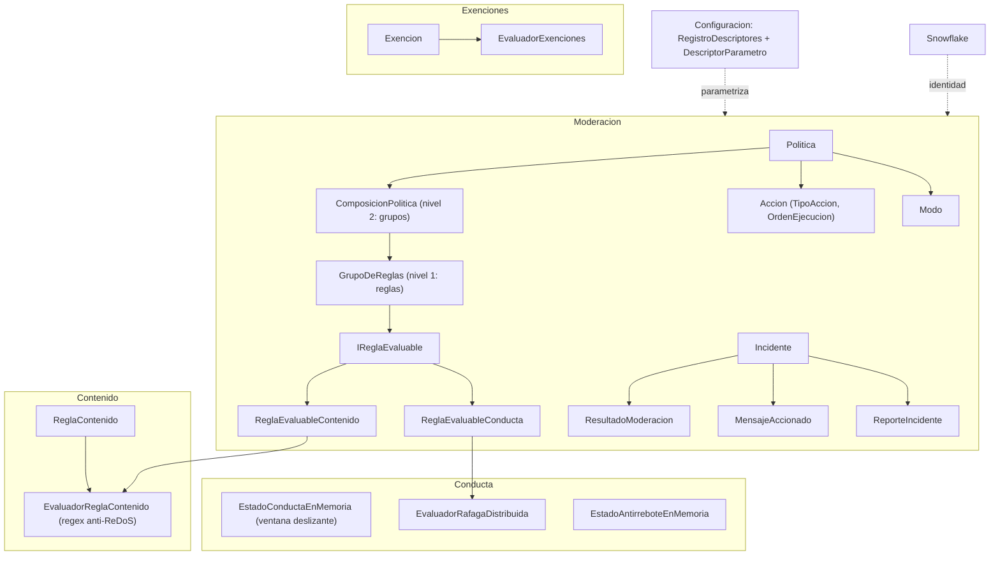

# 02 · Modelo de dominio

> **Propósito.** Destilar el núcleo de negocio puro (`Dominio/`): moderación (política, incidente,
> acción, modo, resultado, reglas y composición), conducta (ráfaga + antirrebote), contenido,
> exenciones, configuración por descriptores, servidores y snowflake. **Fuente primaria:**
> `src/DiscordModeradorBot.Servicio/Dominio/`. El modelo persistido equivalente está en
> [`06_modelo-de-datos.md`](06_modelo-de-datos.md); el vocabulario en [`10_glosario.md`](10_glosario.md).

## Mapa del dominio

## Moderación (`Dominio/Moderacion/`)

### Política

`Politica.cs` — regla de negocio configurada (en persistencia se llama **Evento**). Propiedades:
`Nombre`, `Prioridad` (menor = mayor prioridad, RN-04), `Modo`, `Continuar` (seguir evaluando tras
coincidir), `Acciones` (orden, RN-05), `ReglaContenido?`, `Composicion?`.

Formas de disparo (prioridad de resolución en el motor):

| Forma | Condición | Bandera |
|---|---|---|
| Composición de grupos | `Composicion != null` (nivel 2 de anidamiento booleano, RN-15) | `TieneComposicion` |
| Contenido directo | `ReglaContenido != null` y sin composición (CU-04) | `EsDeContenido` |
| Conducta directa (ráfaga) | sin composición ni regla de contenido (CU-01, R1) | — (default) |

Modo por defecto: `Simulacion` (seguro, RC-10/RN-09). Sin acciones explícitas, default =
`BaneoConBorradoRetroactivo`.

### Composición y grupos de reglas (R7, RN-15)

Dos niveles de anidamiento booleano (no se admite un tercero):

- **Nivel 1 — `GrupoDeReglas`** (`Reglas/GrupoDeReglas.cs`): combina `IReglaEvaluable` según
  `ModoCoincidencia`: `Todas` (AND), `Alguna` (OR), `AlMenosN` (umbral configurable). Un grupo vacío
  se rechaza al construir (`CONFIG_GRUPO_SIN_REGLAS`); N inválido → `CONFIG_GRUPO_N_INVALIDO`.
- **Nivel 2 — `ComposicionPolitica`** (`Reglas/ComposicionPolitica.cs`): combina grupos según
  `ModoCombinacionGrupos`: `Todos` (AND de grupos), `Alguno` (OR de grupos). Composición sin grupos →
  `CONFIG_COMPOSICION_SIN_GRUPOS`.

`IReglaEvaluable` (`Reglas/IReglaEvaluable.cs`): abstracción atómica con `Nombre`, `Clase`
(`ClaseRegla.Contenido`|`Conducta`) y `Evaluar(ContextoEvaluacionRegla)`. Implementaciones:
`ReglaEvaluableContenido` (envuelve `EvaluadorReglaContenido`) y `ReglaEvaluableConducta` (envuelve
`EvaluadorRafagaDistribuida`, sin cambiarlo). `ContextoEvaluacionRegla` empaqueta el mensaje, el
estado de conducta y el instante, de modo que reglas con y sin estado compartan firma.
`ExplicadorEnPalabras.cs` traduce una composición a texto legible para el panel (CU-11).

### Acción y tipos

`Accion.cs` — record `Accion(Tipo, OrdenEjecucion, VentanaBorradoDias=1, DuracionTimeout?, RolObjetivo?)`.

| `TipoAccion` | Contención sobre usuario | Parámetro propio |
|---|---|---|
| `Reportar` / `ReportarACanalPrivado` | No | canal de salida |
| `Banear` / `BaneoConBorradoRetroactivo` | Sí | `VentanaBorradoDias` (0–7, tope 7) |
| `Timeout` | Sí | `DuracionTimeout` (default 10 min) |
| `Expulsar` | Sí | — |
| `AsignarRol` / `QuitarRol` | Sí | `RolObjetivo` (snowflake) |
| `Desbanear` | (desde el panel, no en pipeline) | — |

`VentanaBorradoEfectivaDias` normaliza y **acota al tope de 7 días** (no rechaza; `BORRADO_VENTANA_FUERA_DE_RANGO`),
derivándolo del descriptor. Las acciones de contención pueden quedar `NoAccionable` por jerarquía/permisos.

### Incidente, modo y resultado

`Incidente.cs` — registro persistente de un disparo (RN-11): `ServidorId`, `UsuarioId`,
`NombrePolitica`, `Modo`, `Accion` (representativa: primera contención o primera declarada),
`Resultado`, `MensajesAccionados` (copia previa a remover), `CanalesAfectados`, `Instante`, `Id`, y
estado de reversión (`ReversionAutorId`, `ReversionFecha`). Métodos/props de dominio:
`EsBaneoEjecutado`, `FueRevertido`, `PuedeRevertirse`, `ReclasificarResultado(...)` (solo en modo
`Ejecucion`).

- `Modo.cs`: `Simulacion` (default seguro) | `Ejecucion`.
- `ResultadoModeracion.cs` (conjunto cerrado, RN-01/ADR-08): `NoAccionable`, `Simulada`, `Ejecutada`,
  `Fallida`. El "peor" resultado de las acciones de contención manda (severidad NoAccionable > Fallida > Ejecutada).
- `ResultadoAccion.cs`: resultado de UNA acción contra el adaptador — `Ejecutada`,
  `NoAccionablePorJerarquia`, `NoAccionablePorPermisos`, `Fallida`; `.AResultadoModeracion()` lo mapea.
- `ReporteIncidente.cs`: texto compuesto desde el incidente para el canal de salida; marca simulación
  y advertencia de no accionable (CU-02 §7, TC-60).

## Conducta (`Dominio/Conducta/`, ADR-09)

Estado **en memoria, no persistido** (se reconstruye con el tráfico tras un reinicio).

| Componente | Rol |
|---|---|
| `EstadoConductaEnMemoria` | Ventana deslizante `(canal, instante)` por par `(servidor, usuario)`; poda lo vencido. `CanalesDistintosEnVentana(...)` |
| `EvaluadorRafagaDistribuida` | Cuenta **canales distintos** (no volumen de mensajes) en la ventana; coincide al alcanzar el umbral. Umbral/ventana desde descriptores (RN-10). Devuelve `ResultadoRafaga(Coincide, CanalesDistintos, Umbral)` |
| `EstadoAntirreboteEnMemoria` | Recuerda la última acción por `(servidor, usuario)`; `DebeSuprimir(...)` suprime repeticiones dentro de la ventana; `RegistrarAccion(...)` marca. Tras reinicio, `ANTIRREBOTE_ESTADO_NO_DISPONIBLE` (se trata como no accionado) |

**Ráfaga distribuida**: un mismo usuario publica en varios canales distintos en una ventana corta. Es
el "módulo crítico de detección" (cobertura ≥90%, ver [`07`](07_pruebas-y-calidad.md)).

## Contenido (`Dominio/Contenido/`)

- `ReglaContenido.cs` — predicado **sin estado** sobre el texto de un mensaje. El criterio se
  **valida al construir** (RN-03): un patrón que no compila lanza `ReglaContenidoInvalidaException`
  (`CONTENIDO_PATRON_INVALIDO`). La regex se compila UNA vez con `CultureInvariant` y `matchTimeout`
  obligatorio (anti-ReDoS). `SensibleAMayusculas` (default: no distingue).
- `TipoCriterioContenido`: `ExpresionRegular` (materializado) | `PalabrasClave` (punto de extensión).
- `EvaluadorReglaContenido.cs` — evalúa con tope de tiempo; ante `RegexMatchTimeoutException` devuelve
  `ResultadoEvaluacionContenido(Coincide=false, ExcedioTope=true)` sin propagar (ADR-08,
  `CONTENIDO_EVALUACION_EXCEDE_TIEMPO`).

## Exenciones (`Dominio/Exenciones/`)

- `Exencion.cs` — record `(TipoSujetoExento, Snowflake)`. `TipoSujetoExento`: `Rol`, `Usuario`,
  `Canal`. Fábricas `PorRol/PorUsuario/PorCanal`.
- `EvaluadorExenciones.cs` — predicado puro: un mensaje está exento si el emisor, alguno de sus roles
  o su canal coincide con una exención del servidor (RN-07, CU-15). Se aplica en la **etapa 1** del
  pipeline (descarte previo).

## Configuración por descriptores (`Dominio/Configuracion/`, ADR-12, RN-10)

`DescriptorParametro<T>` es la **fuente única de verdad** de un parámetro: `clave`, `etiqueta`,
`leyenda`, `valorPorDefecto`, `minimo`, `maximo`, `ejemplos`, más `NormalizarOPorDefecto(...)` y
`NormalizarConTope(...)`. `RegistroDescriptores` (estático) los expone. Defaults y rangos:

| Descriptor (clave) | Default | Rango | Uso |
|---|---|---|---|
| `umbral-canales-distintos` (int) | 3 | 2–10 | canales distintos que disparan la ráfaga (CU-01) |
| `ventana-deteccion` (double, s) | 2.0 | 0.5–60 | ventana de la ráfaga (CU-01) |
| `ventana-borrado-retroactivo` (int, días) | 1 | 0–7 | borrado al banear; tope 7 (RN-02) |
| `tope-tiempo-evaluacion-contenido` (int, ms) | 100 | 1–5000 | presupuesto por regex (anti-ReDoS, ADR-08) |
| `ventana-antirrebote` (double, s) | 10.0 | 0.5–300 | supresión de repeticiones (RN-06, CU-16) |

Un valor fuera de rango se **normaliza al default o al tope**, nunca rompe el flujo. Los parámetros
por servidor se persisten en `ParametrosServidor` (ver [`06`](06_modelo-de-datos.md)).

## Servidores y administración

- `Servidores/ServidorRegistrado.cs` — contexto del firewall multi-contexto (ADR-13): `SnowflakeServidor`,
  `TokenCifrado` (nunca en claro, RN-14), `EstadoConexion` (`Desconectado`|`Conectado`),
  `EstadoActivacion` (`Inactivo`|`Activo`; activo solo tras superar la prueba de configuración, RN-16),
  `CanalDeSalida?`.
- `Servidores/CanalDeSalida.cs` — snowflake del canal + propósito lógico (p. ej. `reporte-incidentes`).
- `Servidores/PruebaConfiguracion.cs`, `SolicitudPruebaConfiguracion.cs` — smoke test previo a activar (CU-12).
- `Administracion/Administrador.cs` — administrador único (RC-06): `IdentificadorCuenta` (único),
  `ResguardoPassword` (hash PHC opaco, RN-13). `PoliticaContrasena.cs` valida la política mínima.
  `ControlIntentosAutenticacion.cs` — control de intentos fallidos en memoria (default 5 intentos /
  15 min ventana / 15 min enfriamiento; CU-09, ADR-09).

## Snowflake y mensaje entrante

- `Snowflake.cs` — `readonly record struct`; identificador de 64 bits tratado y persistido como
  **texto** (RN-08, RC-02) para no desbordar el entero con signo. Valida formato (solo dígitos);
  `TryParse`, conversión implícita a string.
- `MensajeEntrante.cs` — record normalizado que entra al pipeline: `ServidorId`, `CanalId`,
  `UsuarioId`, `MensajeId`, `Instante`, `Contenido`, más `RolesDelAutor` (exenciones por rol),
  `NombreCanal`, `NombreUsuario` (para el detalle del incidente, CU-06).
- `Gateway/MapeadorMensajeGremio.cs` — mapeo puro `DatosMensajeGremio → MensajeEntrante?`; descarta
  DM, bots, mensajes de sistema y snowflakes inválidos (sin excepción). `Gateway/ClasificadorResultadoAccion.cs`
  clasifica el resultado de una acción (jerarquía/permisos vs falla de plataforma) de forma pura.

## Gaps / no verificado

- `PalabrasClave` (criterio de contenido) está declarado como punto de extensión, no materializado.
- `AsignarRol`/`QuitarRol` requieren `RolObjetivo`; sin él, la acción se omite (config incompleta).
</content>
