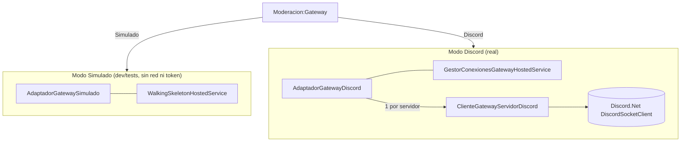

# 04 · Infraestructura

> **Propósito.** Adaptadores concretos de los puertos: gateway (Discord/Simulado), persistencia EF
> Core, seguridad (cifrado/hash), hosted services y composición de dependencias. **Fuente primaria:**
> `src/DiscordModeradorBot.Servicio/Infraestructura/`. Los puertos están en
> [`03_aplicacion-servicios.md`](03_aplicacion-servicios.md); el esquema de datos en
> [`06_modelo-de-datos.md`](06_modelo-de-datos.md); flags y secretos en
> [`09_configuracion-y-seguridad.md`](09_configuracion-y-seguridad.md).

## Gateway (`Infraestructura/Gateway/`)

Selección por flag `Moderacion:Gateway` (enum `ModoGateway`: `Simulado` default | `Discord`).

| Archivo | Rol |
|---|---|
| `AdaptadorGatewaySimulado.cs` | Adaptador activo por defecto: inyecta mensajes simulados y **loguea** las acciones (reporte, baneo, timeout, expulsión, roles) sin tocar la plataforma. Puede simular "no accionable" (`MarcarUsuarioDeRolSuperior`) para demostrar RN-01/ADR-08 |
| `AdaptadorGatewayDiscord.cs` | Adaptador REAL (Discord.Net). Doble rol: **fábrica de conexiones por servidor** (`IFabricaClienteGateway`) y **operaciones de moderación** (`IAdaptadorGateway`). Mapea cada acción a REST y a `ResultadoAccion` sin propagar excepción (ADR-08) |
| `ClienteGatewayServidorDiscord.cs` | Conexión de UN servidor (ADR-13): wrappea `DiscordSocketClient` autenticado con el token descifrado, suscribe mensajes (mapeados por `MapeadorMensajeGremio`), informa estado de conexión. La reconexión la maneja el SDK |
| `ClasificadorFallaGateway.cs` | Lógica pura: reconoce el rechazo de credencial (401 / close 4004 / "Authentication failed") en la prueba de config, sin confundir el 4014 de intents |
| `TraductorFallaDiscord.cs` | Traduce la excepción del SDK (`Discord.Net.HttpException`) a `TipoFallaAccion`: `MissingPermissions` (50001) = jerarquía superior; `InsufficientPermissions` (50013) = falta de permiso; resto = falla de plataforma |
| `IntentsGateway.cs` | Intents requeridos: `Guilds`, `GuildMessages`, `MessageContent` (privilegiado), `GuildMembers` (privilegiado), `GuildBans` |
| `ModoGateway.cs` | Enum `Simulado`/`Discord` |
| `EstadoConexionGatewayEnMemoria.cs` | Registro thread-safe del estado de conexión por servidor (CU-13, ADR-09/13); no persiste |

La clasificación jerarquía/permisos vs falla de plataforma vive en el dominio
(`Dominio/Gateway/ClasificadorResultadoAccion.cs`) para ser testeable sin SDK; el traductor es lo
único acoplado a Discord.Net.

## Persistencia (`Infraestructura/Persistencia/`)

- `ContextoPersistencia.cs` — `DbContext` EF Core sobre SQLite (WAL, ADR-02). Declara los 13 `DbSet`
  y el `OnModelCreating` (tablas, claves, índices, cascadas). Detalle completo del esquema en
  [`06_modelo-de-datos.md`](06_modelo-de-datos.md).
- `ContextoPersistenciaFactory.cs` — factory de tiempo de diseño para las migraciones EF.
- `Entidades/` — 13 entidades de persistencia (`*Entidad.cs`), separadas de los tipos de dominio.
- `Migraciones/` — MIG0001..MIG0009 + snapshot. Ver [`06`](06_modelo-de-datos.md#migraciones).
- Repositorios (scoped): `RepositorioServidores`, `RepositorioIncidentes`, `RepositorioReglasContenido`,
  `RepositorioAdministrador`, `RepositorioExenciones`, `RepositorioConfiguracion`. Traducen entre
  entidades y tipos de dominio; los snowflakes se almacenan como texto y las marcas de tiempo como
  ticks UTC (`long`) mediante `ValueConverter`.

El WAL se activa en `Program.cs` tras `Database.Migrate()` con `PRAGMA journal_mode=WAL`, para tolerar
escrituras concurrentes bot/panel (ADR-02).

## Seguridad (`Infraestructura/Seguridad/`)

| Servicio | Algoritmo | Detalle | Traza |
|---|---|---|---|
| `ServicioCifradoAes` | **AES-GCM** (AES-256) | Cifra el token en reposo (ADR-07, RN-14). Clave maestra de `DISCORDMODERADOR_CLAVE_MAESTRA`; nonce 12 B + tag 16 B por texto (dos cifrados difieren). Sin variable, deriva clave de desarrollo determinista (solo local) | ADR-07 |
| `ServicioHashContrasenaPbkdf2` | **PBKDF2-HMAC-SHA256** | Resguardo PHC `$pbkdf2-sha256$i=ITER$SALT$HASH`; 210 000 iteraciones por defecto (configurable), salt 16 B, hash 32 B; sin paquetes externos (ADR-03, RN-13) | ADR-03 |

Ambos son singletons; la contraseña/token nunca se loguean.

## Hosted services y wiring

| Componente | Rol |
|---|---|
| `WalkingSkeletonHostedService.cs` | (modo Simulado) `BackgroundService` que inyecta escenarios demo end-to-end: ráfaga en simulación (CU-01/CU-14), ejecución con baneo+reporte (CU-02/03/05), contenido (CU-04), exención (CU-15). También **siembra un administrador de desarrollo** SOLO en entorno `Development` (claves `Seed:AdminDesarrollo:*`; ver [`09`](09_configuracion-y-seguridad.md)) |
| `GestorConexionesGatewayHostedService.cs` | (modo Discord) `BackgroundService`: migra, construye el `GestorConexionesGateway`, cablea el ruteo de cada mensaje al motor (un scope por mensaje, porque motor y repositorios son scoped) y abre las conexiones de los servidores activos |
| `RelojDelSistema.cs` | Implementa `IReloj` con la hora real |
| `RegistroDependencias.cs` | Método de extensión `AgregarServiciosModeracion(...)`: registra DbContext, repositorios, singletons de estado/seguridad, evaluadores, servicios de aplicación y el adaptador+hosted service según el flag de gateway |

## Gaps / no verificado

- `AdaptadorGatewayDiscord` y `ClienteGatewayServidorDiscord` requieren conexión WebSocket real; en
  tests se sustituyen por el simulado (excluidos de cobertura unitaria, ver [`07`](07_pruebas-y-calidad.md)).
- El detalle de reconexión/backoff lo maneja el SDK; el código solo observa y reporta el estado.
</content>
