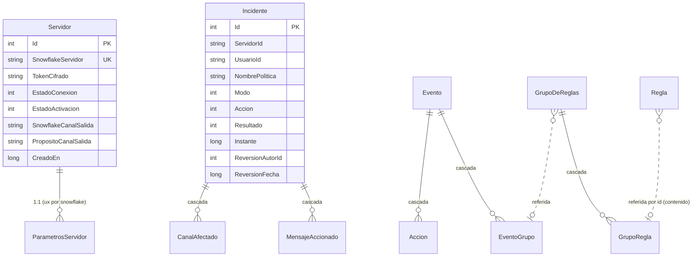

# 06 · Modelo de datos

> **Propósito.** Esquema relacional SQLite normalizado: 13 tablas con claves, índices y cascadas,
> snowflakes como texto, conversión `DateTimeOffset`→ticks, y las 9 migraciones EF. **Fuente
> primaria:** `src/DiscordModeradorBot.Servicio/Infraestructura/Persistencia/ContextoPersistencia.cs`,
> `Entidades/*.cs`, `Migraciones/*.cs`. ADR-02, RN-08. Los tipos de dominio equivalentes en
> [`02_dominio.md`](02_dominio.md).

## Convenciones

- **Motor**: SQLite en modo **WAL** (ADR-02); `PRAGMA journal_mode=WAL` al arrancar.
- **Snowflakes como TEXTO** (RN-08, RC-02): preservan el valor de 64 bits sin desborde y ordenan estable.
- **Marcas de tiempo como ticks UTC (`long`)**: SQLite no traduce `ORDER BY`/comparaciones sobre
  `DateTimeOffset`; `ValueConverter` guarda `UtcTicks` y round-trip sin pérdida (`ReversionFecha` es
  `long?`).
- **PK**: entera autoincremental `Id` en todas las tablas. Snowflakes y enums (guardados como su
  representación) van en columnas propias.

## Diagrama entidad-relación

> El diagrama muestra las relaciones con FK/cascada declaradas en EF. Las referencias por snowflake
> (p. ej. `Incidente.ServidorId` → `Servidor.SnowflakeServidor`) son lógicas, no FK físicas.

## Las 13 tablas

| # | Tabla | Entidad | Contenido | Índices |
|---|---|---|---|---|
| 1 | `Servidor` | `ServidorRegistradoEntidad` | Servidor registrado: snowflake, token cifrado, estados, canal de salida | `ux_servidor_snowflake` (UNIQUE) |
| 2 | `Incidente` | `IncidenteEntidad` | Disparo de política: modo, acción, resultado, instante, reversión | `ix_incidente_servidor_fecha` (ServidorId, Instante) |
| 3 | `MensajeAccionado` | `MensajeAccionadoEntidad` | Copia de mensaje (evidencia): snowflakes, contenido, nombre canal/usuario | `ix_mensaje_accionado_incidente` |
| 4 | `CanalAfectado` | `CanalAfectadoEntidad` | Canal afectado por un incidente | `ix_canal_afectado_incidente` |
| 5 | `Regla` | `ReglaContenidoEntidad` | Regla de contenido: servidor, tipo criterio, criterio, nombre política, sensibilidad | `ix_regla_servidor` |
| 6 | `Administrador` | `AdministradorEntidad` | Administrador único: identificador, resguardo PHC, creado | `ux_administrador_cuenta` (UNIQUE) |
| 7 | `Exencion` | `ExencionEntidad` | Sujeto exento: servidor, tipo sujeto, snowflake sujeto | `ix_exencion_servidor`; `ux_exencion_sujeto` (servidor,tipo,sujeto UNIQUE) |
| 8 | `GrupoDeReglas` | `GrupoDeReglasEntidad` | Grupo: servidor, nombre, modo coincidencia, mínimo coincidencias | `ix_grupo_servidor` |
| 9 | `GrupoRegla` | `GrupoReglaEntidad` | Regla dentro de un grupo: clase, id regla contenido, clave regla conducta | `ix_gruporegla_grupo` |
| 10 | `Evento` | `EventoEntidad` | Política persistida: servidor, nombre, prioridad, continuar, modo, modo combinación grupos | `ix_evento_servidor_prioridad` (servidor,prioridad) |
| 11 | `EventoGrupo` | `EventoGrupoEntidad` | Relación evento↔grupo | `ix_eventogrupo_evento` |
| 12 | `Accion` | `AccionEntidad` | Acción de un evento: tipo, orden, ventana borrado, duración timeout, rol objetivo | `ix_accion_evento_orden` (evento,orden) |
| 13 | `ParametrosServidor` | `ParametrosServidorEntidad` | Parámetros por servidor: umbral canales, ventana detección, ventana antirrebote | `ux_parametros_servidor` (snowflake UNIQUE) |

### Cascadas de borrado (EF `DeleteBehavior.Cascade`)

- `Incidente` → `MensajeAccionado`, `CanalAfectado` (borrar el incidente borra su evidencia).
- `GrupoDeReglas` → `GrupoRegla`.
- `Evento` → `EventoGrupo`, `Accion`.

### Modelo de configuración (R7)

La configuración del panel se persiste normalizada en `Evento` → `EventoGrupo` → `GrupoDeReglas` →
`GrupoRegla` (que referencia `Regla` por id para contenido, o una clave para conducta) → `Accion`.
`CargadorPoliticasDesdeConfiguracion` (ver [`03`](03_aplicacion-servicios.md)) la materializa al
dominio (`Politica`/`ComposicionPolitica`/`GrupoDeReglas`). Los parámetros de ráfaga/antirrebote por
servidor viven en `ParametrosServidor`.

## Migraciones

`Infraestructura/Persistencia/Migraciones/` — se aplican con `Database.Migrate()` al arrancar
(`Program.cs`). Snapshot: `ContextoPersistenciaModelSnapshot.cs`.

| Migración | Aporte |
|---|---|
| `MIG0001EsquemaInicial` | Esquema base (Servidor, Incidente con evidencia inicial) |
| `MIG0002NormalizaEvidenciaYCanalSalida` | Normaliza evidencia a `MensajeAccionado`/`CanalAfectado`; canal de salida en `Servidor` |
| `MIG0003ReglaContenido` | Tabla `Regla` (reglas de contenido, CU-04) |
| `MIG0004AdministradorYReversionIncidente` | Tabla `Administrador`; columnas de reversión en `Incidente` (CU-07) |
| `MIG0005Exencion` | Tabla `Exencion` (CU-15) |
| `MIG0006ConfiguracionGruposEventosAcciones` | Tablas `GrupoDeReglas`, `GrupoRegla`, `Evento`, `EventoGrupo`, `Accion` (R7, CU-11) |
| `MIG0007ParametrosServidor` | Tabla `ParametrosServidor` (parámetros por servidor) |
| `MIG0008NombreCanalMensajeAccionado` | Columna `NombreCanal` en `MensajeAccionado` (CU-06) |
| `MIG0009NombreUsuarioMensajeAccionado` | Columna `NombreUsuario` en `MensajeAccionado` (CU-06) |

Cada migración tiene su `.Designer.cs` (excluidos de cobertura, código generado).

## Gaps / no verificado

- Los tipos SQL exactos por columna (nombres de índice físicos vs. lógicos) provienen del mapeo EF;
  los nombres de índice citados son los descritos en los comentarios de `ContextoPersistencia.cs`.
- El detalle campo a campo de cada entidad vive en `Entidades/*Entidad.cs`.
</content>
