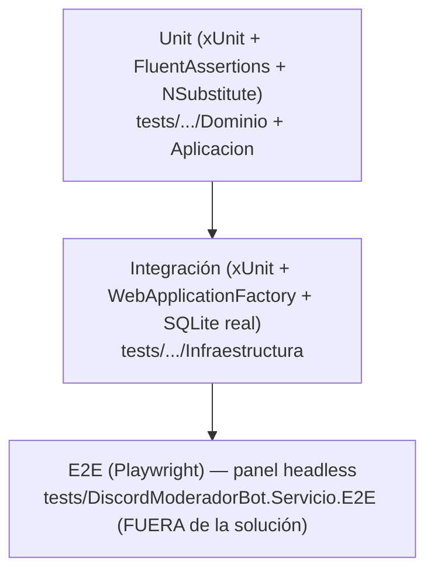

# 07 · Pruebas y calidad

> **Propósito.** Suites de prueba (unit/integración, E2E, benchmarks), umbrales de cobertura y gates
> de calidad. **Fuente primaria:** `tests/`, `perf/`, `coverlet.runsettings`,
> `scripts/ci/verificar-cobertura.ps1`, `.github/workflows/ci.yml`. Docs:
> `SDD2.2D/docs/08_calidad_y_pruebas/` (`estrategia-testing`). Ver DevOps en
> [`08_devops-despliegue.md`](08_devops-despliegue.md).

## Pirámide de pruebas

Estrategia 70/20/10 (unit/integración / E2E, `estrategia-testing`).

## Suite unit + integración (`tests/DiscordModeradorBot.Servicio.Tests`)

- **Framework**: xUnit + FluentAssertions + NSubstitute (dobles).
- **Volumen**: ~43 archivos de prueba, ~241 métodos `[Fact]`/`[Theory]`.
- **Organización**: `Dominio/` (evaluadores de ráfaga, contenido, exenciones, antirrebote, política de
  contraseña, mapeador, reporte, clasificador...), `Aplicacion/` (motor R2/R6/R7, contenido,
  exenciones, config dirigida, servicios, cargador de políticas, validación por descriptor),
  `Infraestructura/` (persistencia por tabla, búsqueda de incidentes, cifrado, hash, clasificador de
  falla, traductor de falla Discord, selección de modo gateway, seed admin desarrollo).
- **Soporte**: `Soporte/RelojFijo.cs` (reloj determinista, `IReloj`), `Soporte/MensajesDePrueba.cs`.
- El gateway real se sustituye por `AdaptadorGatewaySimulado`; la persistencia usa SQLite real.

## Suite E2E (`tests/DiscordModeradorBot.Servicio.E2E`)

- **Playwright** (Chromium) conduce el panel headless; proyecto **fuera de la solución** (no lo
  arrastra el `dotnet test` de la solución; se ejecuta por path en un job CI aparte).
- Fixture: levanta el host real (Kestrel, puerto efímero, SQLite temporal, gateway `Simulado`, entorno
  `E2E` con endpoints de sembrado). Soporte en `Soporte/` (`HostServicioE2E`, `PruebaE2EBase`,
  `HechoSaltable`, `SaltarSiNoHayNavegador` — se saltan si no hay navegador disponible).
- Escenarios: `IngresoE2E`, `PrimerIngresoE2E` (first-run), `ServidoresYConfiguracionE2E`,
  `IncidentesYDesbaneoE2E`.

## Benchmarks (`perf/DiscordModeradorBot.Servicio.Benchmarks`)

- **BenchmarkDotNet**. `MotorDeModeracionBenchmarks` (latencia del pipeline) y `ThroughputBenchmarks`.
- Dobles propios en `Dobles/`: `AdaptadorGatewayNoOp`, `RepositoriosEnMemoria`. Config en
  `ConfiguracionBenchmark.cs`, entry `ProgramaBenchmark.cs`. Workflow `benchmark.yml`.

## Cobertura y gates

Recolección con coverlet (`coverlet.runsettings`, formato Cobertura). Umbrales verificados por
`scripts/ci/verificar-cobertura.ps1` (coverlet no aplica umbrales por namespace).

| Umbral | Valor | Ámbito |
|---|---|---|
| Líneas global | ≥ 75 % | suite unit+integración |
| Branches global | ≥ 65 % | suite unit+integración |
| Líneas módulo de detección | ≥ 90 % | namespace `...Dominio.Conducta` (ráfaga) |

**Exclusiones de cobertura documentadas** (`coverlet.runsettings`): código generado (migraciones,
`*.Designer.cs`, `*ModelSnapshot.cs`, `[GeneratedCode]`/`[ExcludeFromCodeCoverage]`), capa Blazor
(`*.razor`, cubierta por E2E), `Program.cs` y los hosted services de runtime, el adaptador Discord en
vivo (`AdaptadorGatewayDiscord`, `ClienteGatewayServidorDiscord`), y `RelojDelSistema`. El mapeo y la
traducción de fallas del gateway **sí** se cubren.

## Gates de CI (`.github/workflows/ci.yml`)

| Gate | Stage | Comando |
|---|---|---|
| G4 formato | STAGE-01 | `dotnet format --verify-no-changes` |
| G1 build + G5 análisis estático | STAGE-02/03 | `dotnet build -c Release -warnaserror` |
| G2 tests + G3 cobertura | STAGE-04..07 | `dotnet test --settings coverlet.runsettings` + `verificar-cobertura.ps1` |
| E2E | job aparte | `dotnet test` del proyecto e2e por path (instala Chromium `--with-deps`) |
| Supply-chain (SCA + SBOM) | STAGE-08/09 | `dotnet list package --vulnerable` (falla si High/Critical) + CycloneDX SBOM |

## Gaps / no verificado

- El conteo de métodos de prueba (~241) es un `grep` de `[Fact]`/`[Theory]`; el número exacto de
  casos (Theory con múltiples datos) puede ser mayor.
- Los E2E usan `SkippableFact`-style (se saltan sin navegador), por lo que no aparecen como `[Fact]`
  planos en el conteo.
</content>
