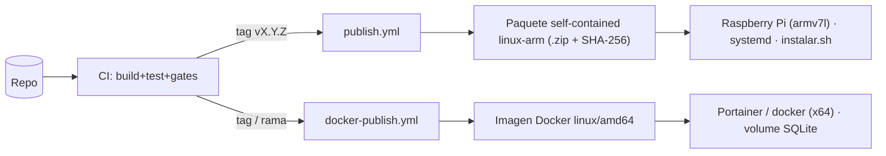

# 08 · DevOps y despliegue

> **Propósito.** Empaquetado y despliegue en las dos plataformas objetivo (Raspberry Pi con systemd y
> contenedor Docker x64), scripts operativos, workflows CI/CD y versionado. **Fuente primaria:**
> `scripts/`, `.github/workflows/`, `Dockerfile`, `Directory.Build.props`, `version.json`. ADR-05,
> ADR-14, ADR-11. Gates de CI en [`07_pruebas-y-calidad.md`](07_pruebas-y-calidad.md).

## Dos objetivos de despliegue

| Objetivo | Runtime | Publicación | Persistencia | ADR |
|---|---|---|---|---|
| Raspberry Pi | self-contained `linux-arm` (armv7l), sin runtime instalado | `scripts/servicio/publicar.sh` (cross-compile desde x64) | SQLite en `/var/lib/discord-bots-admin` | ADR-05 |
| Docker x64 | `mcr.microsoft.com/dotnet/aspnet:10.0`, usuario no-root | `Dockerfile` multi-stage | volume `/app/data` | ADR-14 |

## Scripts (`scripts/`)

| Script | Función |
|---|---|
| `servicio/publicar.sh` / `publicar.ps1` | Publica el paquete self-contained linux-arm, verifica ejecutable + `libe_sqlite3.so`, incluye artefactos de despliegue y genera SHA-256 |
| `servicio/instalar.sh` | Instalador idempotente en el dispositivo: despliega el paquete, registra/actualiza la unidad systemd y **preserva** el archivo de entorno + clave maestra + base SQLite (rollback no toca datos) |
| `servicio/discord-moderador-bot.service` | Unidad systemd (`Type=notify`, `Restart=always`, usuario `discordbot` sin privilegios, hardening) |
| `servicio/backup-sqlite.sh` | Backup del SQLite del contenedor: detiene, copia (checkpoint WAL limpio), zip con timestamp, reinicia |
| `servicio/discord-bots-admin.env.example` | Plantilla del archivo de entorno (clave maestra, flags) |
| `ci/verificar-cobertura.ps1` | Gate G3 de cobertura (ver [`07`](07_pruebas-y-calidad.md)) |
| `local/*.bat` | Build/run local (build-all, run-servicio, run-discord, run-all) |

## Unidad systemd (`discord-moderador-bot.service`)

- `ExecStart=/opt/discord-bots-admin/DiscordModeradorBot.Servicio`; `WorkingDirectory=/opt/discord-bots-admin`.
- `EnvironmentFile=/etc/discord-bots-admin/discord-bots-admin.env` — aloja `DISCORDMODERADOR_CLAVE_MAESTRA`
  (ADR-07); permisos 600, preservado entre reinstalaciones.
- `Restart=always`, `RestartSec=5` (SLO de disponibilidad 99% mensual).
- Hardening: `NoNewPrivileges`, `ProtectSystem=full`, `ProtectHome`, `PrivateTmp`,
  `ReadWritePaths=/var/lib/discord-bots-admin`; logs al journal (`SyslogIdentifier=discord-moderador-bot`).

## Dockerfile

- Multi-stage: build en `sdk:10.0`, runtime en `aspnet:10.0`. Copia `Directory.Build.props`,
  `version.json`, `global.json` **antes** del restore (necesarios para nbgv y para generar los static
  web assets de Blazor; sin ellos `blazor.web.js` no se emite).
- Usuario no-root `appuser:appgroup` (uid/gid 1001); `VOLUME ["/app/data"]`.
- Defaults por env (12-factor, sobreescribibles en Portainer): `Persistencia__RutaBase=/app/data/discordmoderador.db`,
  `Moderacion__Gateway=Simulado`, `ASPNETCORE_URLS=http://+:8080`; `EXPOSE 8080`.

## Workflows CI/CD (`.github/workflows/`)

| Workflow | Disparo | Función |
|---|---|---|
| `ci.yml` | PR/push a `main` | Build+test+gates (G1-G5), E2E (job aparte), supply-chain (SCA + SBOM CycloneDX). Runner `ubuntu-latest` x64 |
| `publish.yml` | tag `vX.Y.Z` (estable) o `vX.Y.Z-rc.N` (prerelease) | Cross-compila el paquete self-contained linux-arm desde x64; deriva la versión con nbgv (no parsea el tag) |
| `docker-publish.yml` | tag / rama | Build & push de la imagen Docker (buildx, metadata-action para tags/labels, cache a registry) |
| `benchmark.yml` | a demanda | Corre los benchmarks NFR (BenchmarkDotNet) |

## Versionado

- **Nerdbank.GitVersioning** (`Directory.Build.props` referencia el paquete con `PrivateAssets=all`).
  `version.json` fija la base `1.0`; nbgv calcula `MAJOR.MINOR.PATCH` con la altura del historial y
  aplica sufijo de prerelease en ramas fuera de `publicReleaseRefs` (`^refs/heads/main$`,
  `^refs/tags/v\d+\.\d+`). `assemblyVersion.precision = major`.
- Se inyecta en todos los proyectos sin tocar cada `.csproj`; aplica también al proyecto e2e (comparte
  el `Directory.Build.props` aunque esté fuera de la solución).

## Supply-chain

El `.csproj` fuerza `SQLitePCLRaw.lib.e_sqlite3` 3.50.3 (SQLite 3.50.x) por encima de la transitiva
2.1.11 vulnerable (GHSA-2m69-gcr7-jv3q), para cumplir el gate "0 vulnerabilidades altas". CI corre
`dotnet list package --vulnerable` (bloqueante) y genera SBOM CycloneDX.

## Gaps / no verificado

- Los tags/labels exactos de la imagen Docker y el registry destino se definen en `docker-publish.yml`
  (metadata-action); no se transcriben aquí.
- ADR-11 (colapso de developer guide en READMEs) es una decisión de proceso; los READMEs operativos
  viven en `scripts/servicio/README.md` y `scripts/local/README.md`.
</content>
