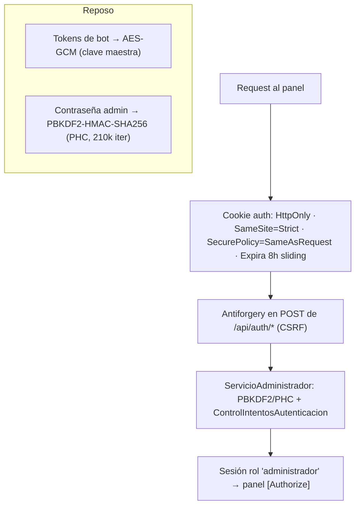

# 09 · Configuración y seguridad

> **Propósito.** Flags de configuración, variables de entorno, clave maestra, descriptores de
> parámetro y postura de seguridad (auth, cifrado, hash, antiforgery, control de intentos). **Fuente
> primaria:** `Program.cs`, `appsettings*.json`, `Infraestructura/Seguridad/`,
> `Dominio/Configuracion/RegistroDescriptores.cs`, `Infraestructura/Gateway/ModoGateway.cs`. ADR-03,
> ADR-05, ADR-07, ADR-12.

## Flags y claves de configuración

Se leen por `IConfiguration` (jerarquía `appsettings.json` < `appsettings.{Environment}.json` <
variables de entorno < user-secrets). En variables de entorno el separador de sección es `__`.

| Clave | Env var | Default | Valores | Efecto |
|---|---|---|---|---|
| `Moderacion:Gateway` | `Moderacion__Gateway` | `Simulado` | `Simulado` \| `Discord` | Adaptador + hosted service (ver [`04`](04_infraestructura.md)) |
| `Persistencia:RutaBase` | `Persistencia__RutaBase` | junto al ejecutable (`discordmoderador.db`) | ruta a archivo | Ubicación del SQLite (Docker: `/app/data/...`; e2e: temporal) |
| `Seed:AdminDesarrollo:Habilitado` | `Seed__AdminDesarrollo__Habilitado` | `true` (solo en `Development`) | `true`/`false` | Siembra admin de desarrollo |
| `Seed:AdminDesarrollo:Usuario` | idem | `admin` | string | Usuario del admin sembrado |
| `Seed:AdminDesarrollo:Contrasena` | idem | `cambiar-esta-clave-2026` | string | Contraseña del admin sembrado |
| `ASPNETCORE_URLS` | env | — | URL | Binding (Docker: `http://+:8080`) |

**Seed de administrador de desarrollo** (`WalkingSkeletonHostedService`): solo en entorno
`Development` y solo si no existe administrador; nunca fuera de Development (RN-13). Se apaga con
`Seed:AdminDesarrollo:Habilitado=false`.

## Secretos y clave maestra

| Secreto | Variable | Uso | Notas |
|---|---|---|---|
| Clave maestra de cifrado | `DISCORDMODERADOR_CLAVE_MAESTRA` | Deriva la clave AES-256 que cifra los tokens de bot en reposo (ADR-07, RN-14) | Vive fuera de la base; en systemd va en el `EnvironmentFile` 600; sin ella se deriva una clave de desarrollo determinista SOLO local |
| Tokens de bot | (en `Servidor.TokenCifrado`) | Autenticación con Discord por servidor | Cifrados con AES-GCM; nunca en claro; descifrados en memoria al conectar; nunca se loguean |

## Descriptores de parámetro (ADR-12, RN-10)

Fuente única de defaults y rangos en `RegistroDescriptores`; el motor nunca hardcodea estos valores.
Los valores por servidor se persisten en `ParametrosServidor`. Ver también [`02`](02_dominio.md#configuración-por-descriptores-dominioconfiguracion-adr-12-rn-10).

| Parámetro | Default | Rango | Fuera de rango |
|---|---|---|---|
| Umbral canales distintos (ráfaga) | 3 | 2–10 | se normaliza al default |
| Ventana de detección (s) | 2.0 | 0.5–60 | se normaliza al default |
| Ventana de borrado retroactivo (días) | 1 | 0–7 | se **acota** al tope 7 (no rechaza) |
| Tope de tiempo de evaluación de contenido (ms) | 100 | 1–5000 | se normaliza al default |
| Ventana de antirrebote (s) | 10.0 | 0.5–300 | se normaliza al default |

## Postura de seguridad

### Autenticación (ADR-03, RN-12/13)

- **Administrador único** (RC-06): una sola cuenta, rol `administrador`. First-run en
  `/configuracion-inicial` (CU-08); login en `/ingresar` (CU-09).
- **Cookie** `DiscordModerador.Auth`: `HttpOnly=true`, `SameSite=Strict`, `SecurePolicy=SameAsRequest`
  (Secure automático bajo HTTPS; funcional sobre HTTP auto-hospedado, ADR-05), `ExpireTimeSpan=8h`,
  `SlidingExpiration=true`.
- **Hash de contraseña**: PBKDF2-HMAC-SHA256, formato PHC (`$pbkdf2-sha256$i=210000$SALT$HASH`), salt
  16 B, hash 32 B. Nunca en claro; nunca se loguea.
- **Control de intentos** (`ControlIntentosAutenticacion`, en memoria): 5 intentos / 15 min ventana /
  15 min enfriamiento por defecto; clave = identificador normalizado + IP (sin enumeración de
  cuentas). Login exitoso resetea el contador.

### Protección de la superficie

- **Antiforgery** con cookie `HttpOnly`/`SameSite=Strict`/`SecurePolicy=SameAsRequest`; todos los POST
  de `/api/auth/*` validan el token (CSRF). Fallo → redirect neutro `?error=ANTIFORGERY`.
- **Sin enumeración de cuentas**: mensajes de login neutros; la clave de intentos no revela existencia.
- **Endpoints de sembrado** solo en entorno `E2E` (no son superficie en dev/producción).
- **Cifrado de tokens en reposo** (AES-GCM autenticado: nonce + tag por texto).
- **Contenedor** no-root (uid/gid 1001); **systemd** con hardening (`NoNewPrivileges`, `ProtectSystem`, ...).
- **Supply-chain**: SQLite parcheado forzado; gate SCA bloqueante en CI (ver [`08`](08_devops-despliegue.md)).

## Gaps / no verificado

- ADR-06 (compliance Ley 25.326) es una decisión de proceso/datos personales; su materialización
  concreta (p. ej. retención/anonimización) no se verificó en el código escaneado. Marcado.
- La política de contraseña mínima (`Dominio/Administracion/PoliticaContrasena.cs`) define los
  criterios exactos de fortaleza; no se transcriben aquí.
</content>
